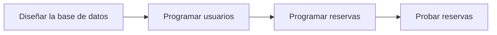
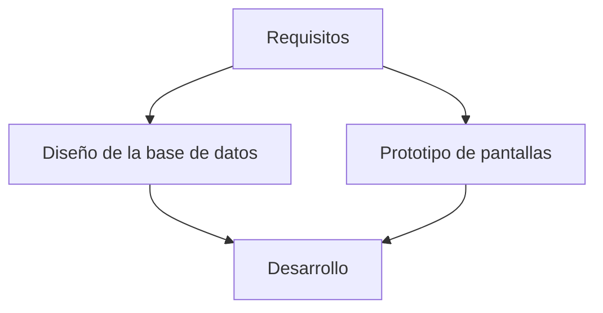

# Estimación y dependencias

## ¿Por qué es difícil estimar?

Estimar es predecir cuánto tiempo llevará algo que todavía no has hecho. Casi todo el mundo, al empezar, estima por debajo de lo real.

!!! warning "Error frecuente"

    Estimar pensando en el mejor caso: «si todo sale bien, me llevará dos horas». Los imprevistos existen, y hay que contarlos.

---

## Cómo estimar mejor

### 1. Divide

Es más fácil estimar una tarea pequeña que una grande. Si no sabes estimar una tarea, divídela.

### 2. Compara

Piensa en algo parecido que ya hayas hecho. ¿Cuánto te llevó?

### 3. Pregunta a otra persona

La estimación de dos personas suele ser mejor que la de una sola.

### 4. Añade margen

Aplica un **margen de seguridad** al total, por ejemplo un 20 %.

!!! tip "Unidad de medida"

    Estima en **horas** y luego conviértelas a días según el tiempo que realmente puedes dedicar al proyecto.

---

## Dependencias entre tareas

Una **dependencia** existe cuando una tarea no puede empezar hasta que otra termine.



### Tareas que dependen y tareas independientes



!!! info "Idea clave"

    Las tareas independientes pueden hacerse a la vez. Las dependientes, no.

### La ruta más larga

La **ruta crítica** es la secuencia más larga de tareas dependientes. Marca el tiempo mínimo del proyecto: si una tarea de esa ruta se retrasa, se retrasa todo el proyecto.

---

## Caso práctico · ReservaSport

| Código | Tarea | Horas | Depende de |
|-------|--------|:-----:|--------|
| T1 | Redactar requisitos y casos de uso | 10 | — |
| T2 | Diseñar la base de datos | 10 | T1 |
| T3 | Diseñar el prototipo de pantallas | 12 | T1 |
| T4 | Programar la gestión de usuarios | 16 | T2 |
| T5 | Programar la consulta de disponibilidad | 14 | T4 |
| T6 | Programar la realización de reservas | 16 | T5 |
| T7 | Programar la cancelación de reservas | 8 | T6 |
| T8 | Realizar pruebas funcionales | 10 | T7 |
| T9 | Redactar la documentación final | 8 | T8 |
| | **Total** | **104** | |
| | **Margen del 20 %** | **≈ 21** | |
| | **Total con margen** | **≈ 125** | |

!!! note "Observa"

    T2 y T3 dependen de T1 pero no entre sí. Pueden hacerse en paralelo.

---

## Actividad 1 · Estima una tarea

Tarea: *«Programar el formulario de registro de usuarios»*.

1. Divídela en subtareas.
2. Estima las horas de cada una.
3. Suma y añade un 20 % de margen.

??? success "Solución orientativa"

    Subtareas posibles: diseñar el formulario (2 h), programar la validación (3 h), guardar en la base de datos (3 h), mostrar mensajes de error (2 h), probar (2 h). Total: 12 h. Con margen: unas 14-15 h.

---

## Actividad 2 · Planning poker en parejas

Una dinámica para practicar la estimación.

1. Cada persona de la pareja tiene su lista de tareas (la de la actividad 3 de la página anterior).
2. Se turnan: una persona lee una tarea.
3. Las dos escriben, **sin enseñarlo**, su estimación en horas.
4. Se enseñan los números a la vez.
5. Si difieren mucho, cada una explica su razonamiento y se estima de nuevo.
6. Se anota la estimación acordada.

!!! tip "Qué aprender"

    La diferencia entre estimaciones suele revelar una tarea mal definida o un detalle que una persona no había considerado.

??? success "Resultado esperado"

    Una lista de tareas con horas acordadas por dos personas y algunas tareas reformuladas o divididas.

---

## Actividad 3 · Dependencias imposibles

Detecta el error:

> T1. Programar las reservas (depende de T3)
> T2. Diseñar la base de datos (depende de T1)
> T3. Programar la gestión de usuarios (depende de T2)

??? success "Solución orientativa"

    Hay un ciclo: T1 depende de T3, T3 de T2 y T2 de T1. Ninguna podría empezar. El orden lógico sería T2 → T3 → T1.

---

## Actividad 4 · Tu tabla de tareas

Completa para tu proyecto:

```text
| Código | Tarea | Horas | Depende de |
|--------|-------|-------|------------|
|        |       |       |            |
```

1. Estima todas las tareas.
2. Indica de qué tarea depende cada una.
3. Suma las horas y añade el margen.

---

## Ejemplos de redacción para la memoria

| Nivel | Ejemplo |
|---------|---------|
| ❌ Pobre | El proyecto durará unas semanas. |
| ⚠️ Básico | El proyecto necesitará unas 100 horas. |
| ✅ Bueno | Se estima una dedicación total de 104 horas, más un margen del 20 % para imprevistos. |
| ⭐ Excelente | Se estima una dedicación de 104 horas distribuidas en nueve tareas, a las que se añade un margen del 20 % (total aproximado de 125 horas). Las estimaciones se han contrastado por parejas y se han identificado las dependencias entre tareas. |

---

## ¿Cómo aparecerá esto en la memoria?

### Plantilla reutilizable

```text
La estimación de tiempos del proyecto se resume en la siguiente tabla:

[Tabla: código, tarea, horas, depende de]

El total estimado es de ... horas.

Se ha añadido un margen del ... % para imprevistos, por lo que el total previsto es de ... horas.

Las tareas que no dependen entre sí (...) pueden realizarse en paralelo.
```

### Ejemplo

> Se estima una dedicación total de 104 horas, a las que se añade un margen del 20 % para imprevistos. Las tareas de diseño de la base de datos y de prototipado pueden realizarse en paralelo, ya que ambas dependen únicamente del análisis de requisitos.

---

## Lo que irá a la memoria

```text
3.3. Estimación de tiempos y dependencias

- Tabla de tareas con horas.
- Dependencias entre tareas.
- Margen de seguridad.
- Total estimado.
```

---

## Autoevaluación

- [ ] He estimado todas mis tareas en horas.
- [ ] He añadido un margen de seguridad.
- [ ] He indicado de qué depende cada tarea.
- [ ] He comprobado que no hay dependencias imposibles.
- [ ] Sé qué tareas pueden hacerse a la vez.
- [ ] Podría redactar el apartado 3.3 de mi memoria.