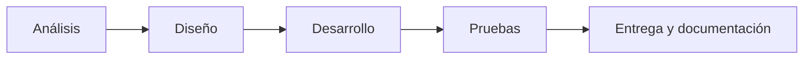
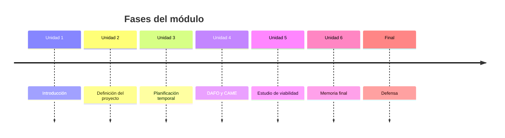

# Fases del proyecto

## ¿Qué es una fase?

Una fase es un bloque de trabajo con un objetivo propio. Al terminar una fase, hay algo concreto que se puede comprobar.

Dividir el proyecto en fases permite no pensar en «todo» a la vez.

!!! info "Idea clave"

    Las fases responden a la pregunta: ¿en qué grandes etapas se divide mi proyecto?

---

## Las fases habituales de un proyecto web



| Fase | Qué se hace | Resultado |
|--------|--------|--------|
| Análisis | Concretar requisitos y casos de uso a partir del MVP. | Lista de requisitos. |
| Diseño | Diseñar la base de datos y los prototipos de pantallas. | Modelo de datos y bocetos. |
| Desarrollo | Construir las funcionalidades del MVP. | Aplicación funcionando. |
| Pruebas | Comprobar que todo funciona como se espera. | Lista de pruebas realizadas. |
| Entrega y documentación | Cerrar el proyecto y documentarlo. | MVP entregado y documentado. |

!!! tip "Adapta las fases a tu proyecto"

    No todos los proyectos tienen exactamente estas fases. Lo importante es que las tuyas tengan sentido y que cada una termine en un resultado comprobable.

---

## Fases del módulo (el plan del curso)

Además de las fases de tu aplicación, tú tienes tus propias fases como estudiante: las unidades del módulo.



### Reparto orientativo de las ~20 semanas

| Bloque | Semanas orientativas |
|--------|--------|
| Unidad 1 · Introducción | 1 |
| Unidad 2 · Definición del proyecto | 2 – 5 |
| Unidad 3 · Planificación temporal | 6 – 8 |
| Unidad 4 · DAFO y CAME | 9 – 11 |
| Unidad 5 · Estudio de viabilidad | 12 – 14 |
| Unidad 6 · Memoria final | 15 – 19 |
| Defensa | 20 |

!!! note "Reparto orientativo"

    Tu profesor o profesora ajustará estas semanas al calendario real del curso.

---

## Caso práctico 1 · Reservas deportivas

| Fase | Contenido |
|--------|--------|
| Análisis | Requisitos y casos de uso de ciudadano, administrativo y administrador. |
| Diseño | Modelo de datos de instalaciones, usuarios y reservas. Prototipo de pantallas. |
| Desarrollo | Usuarios, consulta de disponibilidad, reservas y cancelaciones. |
| Pruebas | Pruebas funcionales de reservas y cancelaciones. |
| Entrega | Documentación y entrega del MVP. |

## Caso práctico 2 · Biblioteca escolar

| Fase | Contenido |
|--------|--------|
| Análisis | Requisitos de alumnado, profesorado y administrador. |
| Diseño | Modelo de datos de libros, usuarios y préstamos. |
| Desarrollo | Buscador, disponibilidad, préstamos y devoluciones. |
| Pruebas | Pruebas de préstamos y devoluciones. |
| Entrega | Documentación y entrega del MVP. |

---

## Error frecuente: fases sin resultado

### Incorrecto

- Fase 1: Empezar.
- Fase 2: Trabajar en el proyecto.
- Fase 3: Terminar.

### Correcto

- Fase 1: Análisis → lista de requisitos.
- Fase 2: Diseño → modelo de datos y prototipo.
- Fase 3: Desarrollo → MVP funcionando.

!!! warning "Error frecuente"

    Definir fases que no se pueden comprobar. Si no sabes cuándo has terminado una fase, no es una fase útil.

---

## Actividad 1 · Clasifica las tareas por fases

Asigna cada tarea a su fase (análisis, diseño, desarrollo, pruebas o entrega):

1. Dibujar el boceto de la pantalla de reservas.
2. Programar el formulario de registro.
3. Redactar la lista de requisitos.
4. Comprobar que no se puede reservar una hora ya ocupada.
5. Escribir el manual de uso.
6. Diseñar las tablas de la base de datos.

??? success "Solución orientativa"

    1. Diseño.
    2. Desarrollo.
    3. Análisis.
    4. Pruebas.
    5. Entrega y documentación.
    6. Diseño.

---

## Actividad 2 · Planificar hacia atrás

Esta es la actividad de calentamiento con el plan del módulo.

1. Anota la **fecha de la defensa** (semana 20).
2. Anota las fechas de entrega que te dé tu profesor o profesora.
3. Coloca en una línea temporal, hacia atrás, los hitos del módulo: memoria final, estudio de viabilidad, DAFO y CAME, planificación.
4. Comprueba que dejas al menos **una semana de margen** antes de la defensa.

??? success "Solución orientativa"

    Un buen plan hacia atrás deja una semana libre antes de la defensa y no concentra la redacción de la memoria en las últimas dos semanas. Cada unidad aporta un apartado, y se redacta mientras se estudia.

---

## Actividad 3 · Las fases de tu proyecto

Completa para tu proyecto:

```text
Fase 1:                  Resultado:

Fase 2:                  Resultado:

Fase 3:                  Resultado:

Fase 4:                  Resultado:

Fase 5:                  Resultado:
```

---

## Ejemplos de redacción para la memoria

| Nivel | Ejemplo |
|---------|---------|
| ❌ Pobre | El proyecto tendrá varias fases. |
| ⚠️ Básico | El proyecto se divide en análisis, diseño, desarrollo y pruebas. |
| ✅ Bueno | El proyecto se divide en cinco fases: análisis, diseño, desarrollo, pruebas y entrega. |
| ⭐ Excelente | El proyecto se divide en cinco fases secuenciales. Cada fase termina con un resultado comprobable: lista de requisitos, modelo de datos y prototipo, MVP funcional, registro de pruebas y documentación final. |

---

## ¿Cómo aparecerá esto en la memoria?

### Plantilla reutilizable

```text
El proyecto se divide en las siguientes fases:

Fase 1. [Nombre]: [qué se hace]. Resultado: [entregable].

Fase 2. [Nombre]: [qué se hace]. Resultado: [entregable].

Esta división se justifica porque...
```

### Ejemplo

> El proyecto ReservaSport se divide en cinco fases secuenciales: análisis, diseño, desarrollo, pruebas y entrega. Esta división permite comprobar el avance al final de cada fase y detectar desviaciones de forma temprana.

---

## Lo que irá a la memoria

```text
3.1. Fases del proyecto

- Lista de fases.
- Qué se hace en cada una.
- Resultado de cada fase.
```

---

## Autoevaluación

- [ ] Sé qué es una fase.
- [ ] He dividido mi proyecto en fases.
- [ ] Cada fase termina en un resultado comprobable.
- [ ] He colocado los hitos del módulo en un calendario.
- [ ] Podría redactar el apartado 3.1 de mi memoria.