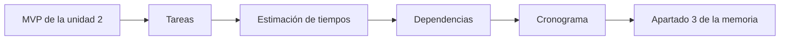

# Unidad 3 · Planificación temporal

!!! abstract "Objetivo de la unidad"

    En esta unidad aprenderás a planificar tu proyecto en el tiempo y a redactar el apartado **3. Planificación temporal** de la memoria.

    Al finalizar serás capaz de explicar:

    - Qué fases tiene tu proyecto.
    - Qué tareas son necesarias para construir tu MVP.
    - Cuánto tiempo necesita cada tarea.
    - En qué orden deben realizarse.
    - Qué puede retrasar el proyecto y cómo reaccionar.

---

## Relación con la memoria

En la unidad 2 definiste **qué** vas a hacer (apartados 2.1 y 2.2). En esta unidad defines **cuándo** y **en qué orden** lo vas a hacer.

El apartado **3. Planificación temporal** incluirá:

- 3.1. Fases del proyecto.
- 3.2. Tareas e hitos.
- 3.3. Estimación de tiempos y dependencias.
- 3.4. Cronograma.
- 3.5. Seguimiento y riesgos del calendario.

!!! success "¿Qué conseguirás al finalizar la unidad?"

    Tendrás un plan realista y justificado para desarrollar el MVP que definiste en la unidad 2, listo para incluir en tu memoria.

---

## Del alcance al calendario

---

## Actividad 0 · Antes de empezar

Esta unidad parte de tu trabajo de la unidad 2. Antes de continuar, reúne en **un único documento** tus apartados 2.1 y 2.2 y comprueba que tienes lo necesario.

- [ ] Mi problema y mis usuarios están descritos.
- [ ] Mi alcance inicial está escrito.
- [ ] Tengo una lista clara de las funcionalidades de mi MVP.
- [ ] Tengo definidos mi objetivo general y mis objetivos específicos.

!!! tip "Consejo"

    La lista de funcionalidades del MVP es la materia prima de esta unidad. Si es vaga, tu planificación también lo será.

---

## Lista de comprobación

- [ ] Sé por qué conviene planificar.
- [ ] Sé dividir mi proyecto en fases.
- [ ] Sé convertir mi MVP en tareas concretas.
- [ ] Sé estimar el tiempo de una tarea y dejar margen.
- [ ] Sé representar mi plan en un diagrama de Gantt.
- [ ] Sé identificar riesgos que pueden retrasar mi proyecto.
- [ ] Entiendo qué debe contener el apartado 3 de la memoria.

---