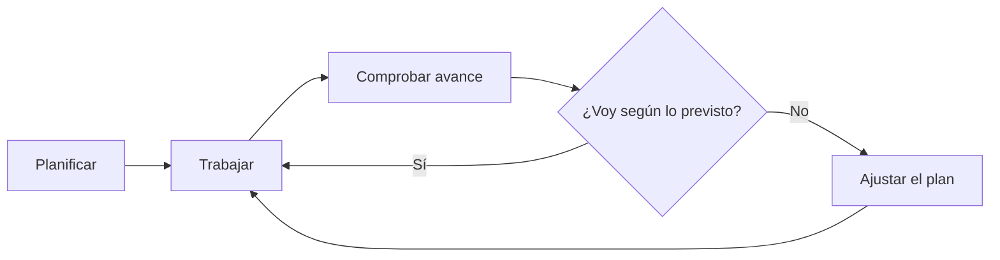
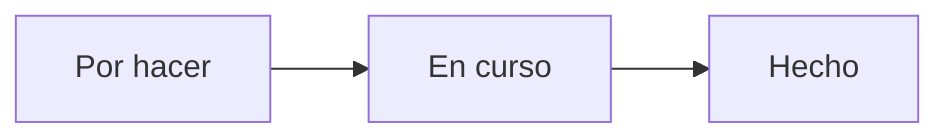

# Seguimiento y riesgos

## Un plan no se cumple solo

Hacer un plan es solo la mitad del trabajo. La otra mitad es **comprobar con regularidad si lo estás cumpliendo** y reaccionar a tiempo cuando no es así.

!!! info "Idea clave"

    Un retraso pequeño detectado pronto se corrige. Un retraso grande detectado al final, no.



---

## Seguimiento con un tablero Kanban

Un tablero Kanban muestra el estado de cada tarea en columnas.



| Columna | Qué contiene |
|--------|--------|
| **Por hacer** | Tareas pendientes, ordenadas por prioridad. |
| **En curso** | Tareas en las que se está trabajando ahora. Conviene que sean pocas. |
| **Hecho** | Tareas terminadas y comprobadas. |

!!! tip "Regla útil"

    Limita las tareas «En curso» a una o dos. Empezar muchas cosas a la vez es una forma habitual de no terminar ninguna.

### Cómo montarlo en GitHub Projects

1. Entra en tu repositorio de GitHub y abre la pestaña **Projects**.
2. Crea un proyecto nuevo y elige la plantilla **Board** (tablero).
3. Crea una tarea (*issue* o tarjeta) por cada tarea de tu plan.
4. Escribe en cada una su duración estimada y de qué depende.
5. Mueve las tarjetas entre columnas a medida que avanzas.

!!! note "Qué se practica"

    Aunque la memoria no sea código, el tablero te introduce en el uso de GitHub como herramienta de trabajo.

---

## Riesgos del calendario

Un **riesgo** es algo que puede ocurrir y retrasar el proyecto. Identificarlos de antemano permite preparar una respuesta.

| Riesgo | Probabilidad | Impacto | Qué hacer |
|--------|:------:|:------:|--------|
| Una tarea tarda el doble de lo previsto | Alta | Alto | Dejar margen y revisar estimaciones cada semana. |
| Enfermedad o ausencia de varios días | Media | Medio | Mantener un margen final antes de la fecha límite. |
| Cambiar el alcance a mitad de proyecto | Media | Alto | Mantener el alcance definido en la unidad 2. |
| Dependencia de una tarea mal hecha | Media | Alto | Comprobar cada tarea al terminarla. |
| Perder archivos o versiones | Baja | Alto | Trabajar en un repositorio con copias. |

!!! success "Los riesgos preparan el DAFO"

    En la unidad 4 analizarás debilidades y amenazas. Los riesgos del calendario son un buen punto de partida.

---

## ¿Y si voy tarde?

Cuando el plan se desvía, hay tres opciones:

1. **Trabajar más horas.** Solo sirve para retrasos pequeños.
2. **Mover la fecha.** A veces no es posible.
3. **Recortar el alcance.** Dejar fuera funcionalidades secundarias.

!!! tip "Por eso es importante el MVP"

    Definir bien qué es esencial en la unidad 2 te permite recortar lo secundario sin perder el valor del proyecto.

---

## Caso práctico · ReservaSport va con retraso

Al terminar la tarea de reservas se detecta que se han gastado 24 horas en lugar de las 16 previstas.

### Opciones

- Reducir la tarea de cancelación de reservas a una versión mínima.
- Usar parte del margen del 20 %.
- Mover las notificaciones avanzadas a futuras ampliaciones (ya estaban fuera del alcance).

### Decisión razonable

Usar parte del margen y simplificar la cancelación, sin tocar las funcionalidades esenciales.

---

## Actividad 1 · Monta tu tablero

1. Crea un tablero Kanban en GitHub Projects.
2. Añade como tarjetas las tareas de tu plan.
3. Coloca cada una en su columna.
4. Haz una captura del tablero para tu memoria.

---

## Actividad 2 · Identifica tus riesgos

Escribe **tres riesgos** que podrían retrasar tu proyecto y completa la tabla.

```text
| Riesgo | Probabilidad | Impacto | Qué hacer |
|--------|--------------|---------|-----------|
|        |              |         |           |
```

??? success "Orientación"

    Un buen riesgo es concreto y tiene una medida asociada. «Todo puede salir mal» no sirve; «una tarea tarda el doble» sí, y se responde con margen y revisión semanal.

---

## Actividad 3 · Decide qué recortar

Un proyecto de biblioteca escolar va con una semana de retraso. Su MVP incluye: buscar libros, consultar disponibilidad, registrar préstamos, registrar devoluciones y un buscador avanzado.

¿Qué recortarías?

??? success "Solución orientativa"

    Recortar o simplificar el buscador avanzado, que es secundario. Mantener buscar libros, disponibilidad, préstamos y devoluciones, que resuelven el problema principal.

---

## Ejemplos de redacción para la memoria

| Nivel | Ejemplo |
|---------|---------|
| ❌ Pobre | Si hay problemas, se resolverán. |
| ⚠️ Básico | Pueden aparecer retrasos. |
| ✅ Bueno | Se han identificado tres riesgos principales que podrían retrasar el proyecto, con una medida para cada uno. |
| ⭐ Excelente | Se han identificado cinco riesgos de calendario, valorados por probabilidad e impacto. El seguimiento se realizará con un tablero Kanban revisado semanalmente y, si hay desviaciones, se recortarán funcionalidades secundarias antes que las esenciales. |

---

## ¿Cómo aparecerá esto en la memoria?

### Plantilla reutilizable

```text
El seguimiento del proyecto se realizará mediante...

Se revisará el avance con una frecuencia...

Los principales riesgos del calendario son:

[Tabla: riesgo, probabilidad, impacto, qué hacer]

En caso de retraso se actuará de la siguiente manera...
```

### Ejemplo

> El seguimiento se realizará mediante un tablero Kanban revisado cada semana. En caso de retraso se utilizará primero el margen previsto y, si no es suficiente, se simplificarán las funcionalidades secundarias del MVP.

---

## Lo que irá a la memoria

```text
3.5. Seguimiento y riesgos del calendario

- Herramienta de seguimiento.
- Frecuencia de revisión.
- Tabla de riesgos.
- Plan ante desviaciones.
```

---

## Autoevaluación

- [ ] Sé qué es un tablero Kanban.
- [ ] He montado mi tablero con las tareas del plan.
- [ ] He identificado al menos tres riesgos.
- [ ] Sé qué haría si voy con retraso.
- [ ] Podría redactar el apartado 3.5 de mi memoria