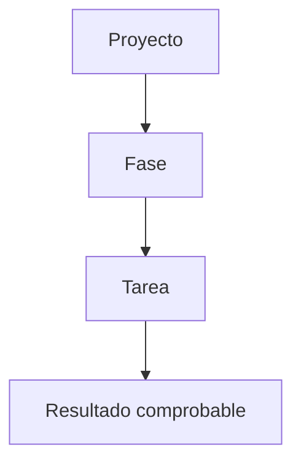
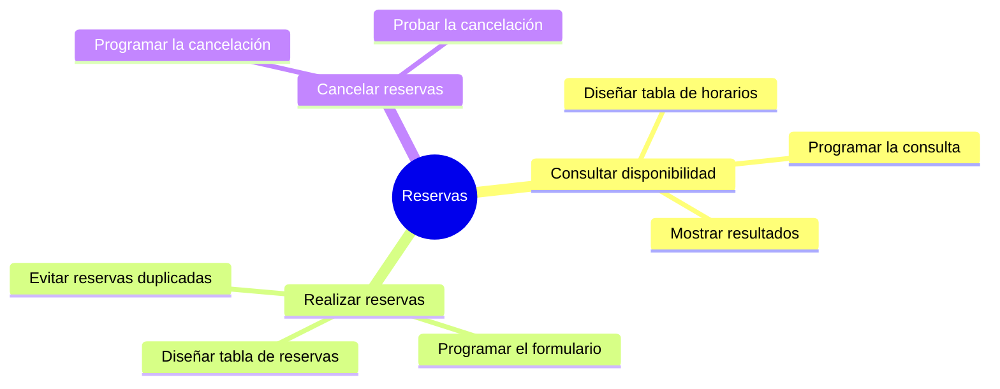

# Tareas e hitos

## De las fases a las tareas

Una fase es demasiado grande para trabajar con ella directamente. Hay que dividirla en **tareas**: acciones concretas que una persona puede hacer y dar por terminadas.



---

## Tarea, fase e hito

| Concepto | Qué es | Ejemplo |
|--------|--------|--------|
| **Fase** | Un gran bloque de trabajo. | Desarrollo. |
| **Tarea** | Una acción concreta con duración. | Programar el formulario de registro. |
| **Hito** | Un momento importante, sin duración. | MVP funcionando. |

!!! info "Idea clave"

    Las tareas se hacen. Los hitos se alcanzan. Un hito marca que algo importante está terminado.

---

## Cómo dividir el MVP en tareas

La unidad 2 te dejó una lista de funcionalidades. Ahora cada funcionalidad se convierte en varias tareas.



---

## Características de una buena tarea

| Característica | Pregunta |
|---|---|
| Concreta | ¿Se entiende qué hay que hacer? |
| Terminable | ¿Sé cuándo está terminada? |
| Del tamaño adecuado | ¿Cabe aproximadamente entre medio día y tres días? |
| Útil | ¿Contribuye a una funcionalidad del MVP? |

### Truco de redacción

Empieza con un **verbo** y acaba con un **resultado**.

| ❌ Pobre | ✅ Mejor |
|--------|--------|
| Base de datos | Diseñar las tablas de usuarios, instalaciones y reservas |
| Hacer la web | Programar la pantalla de consulta de horarios |
| Pruebas | Comprobar que no se puede reservar una hora ocupada |

!!! warning "Error frecuente"

    Escribir tareas enormes («hacer la web») o minúsculas («cambiar un color»). Las primeras no se pueden estimar y las segundas llenan el plan de ruido.

---

## Hitos

Los hitos son puntos de control. Sirven para saber si vas bien.

### Hitos de ejemplo

- Requisitos aprobados.
- Base de datos diseñada.
- Primera funcionalidad completa.
- MVP funcionando.
- Documentación entregada.

!!! tip "Cuántos hitos"

    Con 3 a 5 hitos bien elegidos es suficiente.

---

## Caso práctico 1 · Biblioteca escolar

### Funcionalidad: registrar préstamos

- Diseñar la tabla de préstamos.
- Programar el formulario de préstamo.
- Validar que el libro está disponible.
- Probar el préstamo con varios casos.

### Hito

- Préstamos funcionando.

## Caso práctico 2 · Gestión de incidencias

### Funcionalidad: crear incidencia

- Diseñar la tabla de incidencias.
- Programar el formulario de creación.
- Mostrar la incidencia creada al usuario.

### Hito

- Creación de incidencias funcionando.

---

## Actividad 1 · ¿Tarea o hito?

Clasifica:

1. Programar el formulario de login.
2. Login funcionando.
3. Redactar los casos de uso.
4. Entrega del MVP.

??? success "Solución orientativa"

    Tareas: 1 y 3.

    Hitos: 2 y 4.

---

## Actividad 2 · Mejora las tareas

Reescribe estas tareas para que sean concretas:

1. Hacer la web.
2. Base de datos.
3. Pruebas.

??? success "Posible mejora"

    1. Programar la pantalla de consulta de disponibilidad.
    2. Diseñar las tablas de usuarios, instalaciones y reservas.
    3. Comprobar que no se puede reservar una instalación ocupada.

---

## Actividad 3 · Del MVP a las tareas

Esta es la actividad central de la unidad.

1. Copia la lista de funcionalidades de tu MVP.
2. Para cada funcionalidad, escribe de **2 a 4 tareas**.
3. Añade las tareas de análisis, diseño, pruebas y entrega.
4. Obtendrás una lista de **8 a 12 tareas** como mínimo.
5. Marca 3 a 5 hitos.

```text
Funcionalidad 1:
  - Tarea 1.1:
  - Tarea 1.2:

Funcionalidad 2:
  - Tarea 2.1:
  - Tarea 2.2:

Hitos:
  - 
```

---

## Ejemplos de redacción para la memoria

| Nivel | Ejemplo |
|---------|---------|
| ❌ Pobre | Habrá que hacer muchas tareas. |
| ⚠️ Básico | Las tareas son: base de datos, programación y pruebas. |
| ✅ Bueno | Las tareas incluyen el diseño de la base de datos, la programación de las funcionalidades del MVP y las pruebas. |
| ⭐ Excelente | El proyecto se divide en 12 tareas agrupadas por fase. Cada tarea está asociada a una funcionalidad del MVP y se marca con un hito el cierre de cada bloque: requisitos aprobados, base de datos diseñada, MVP funcionando y documentación entregada. |

---

## ¿Cómo aparecerá esto en la memoria?

### Plantilla reutilizable

```text
Las tareas del proyecto, agrupadas por fases, son:

Fase 1 · [Nombre]
- T1. [Verbo + resultado]
- T2. [Verbo + resultado]

Los hitos del proyecto son:
- H1. [Resultado alcanzado]
- H2. [Resultado alcanzado]
```

### Ejemplo

> En la fase de desarrollo se incluyen las tareas de gestión de usuarios, consulta de disponibilidad, realización de reservas y cancelación de reservas. El primer hito será alcanzado cuando un usuario pueda consultar la disponibilidad desde la aplicación.

---

## Lo que irá a la memoria

```text
3.2. Tareas e hitos

- Tabla de tareas por fase.
- Hitos del proyecto.
- Relación de las tareas con el MVP.
```

---

## Autoevaluación

- [ ] Diferencio fase, tarea e hito.
- [ ] Mis tareas empiezan con un verbo y tienen un resultado.
- [ ] Cada funcionalidad del MVP tiene tareas asociadas.
- [ ] He marcado entre 3 y 5 hitos.
- [ ] Podría redactar el apartado 3.2 de mi memoria.