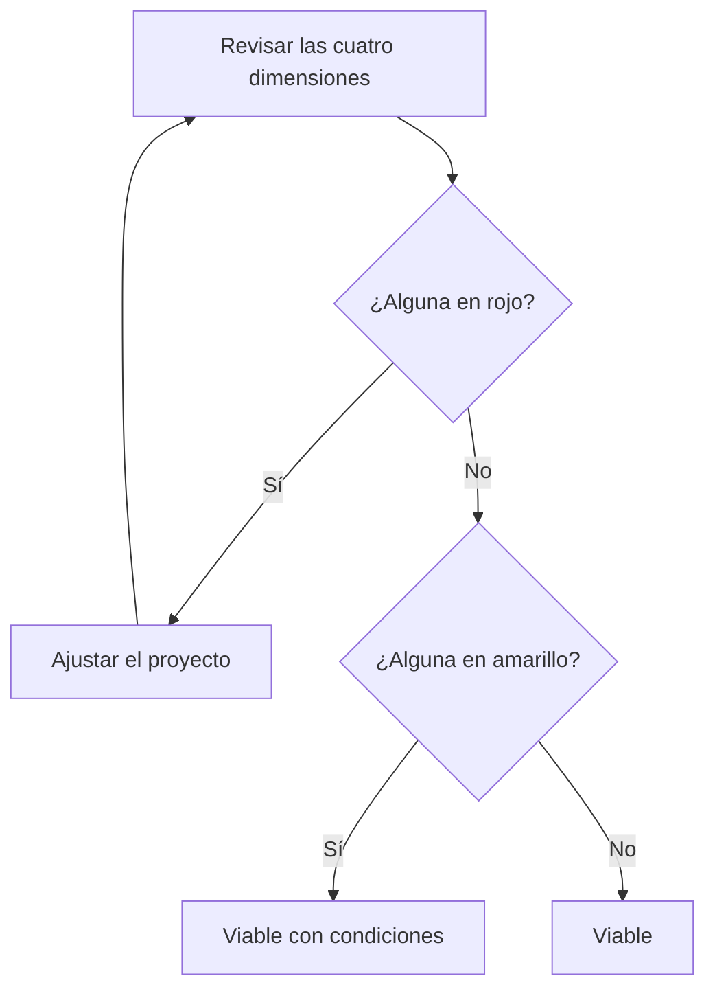

# Conclusión de viabilidad

## Juntar las piezas

Ya has comprobado los recursos y las cuatro dimensiones de la viabilidad. Ahora toca cerrar con un **dictamen**: una respuesta clara y razonada a la pregunta *«¿es viable mi proyecto?»*.

---

## El cuadro resumen

Reúne el resultado de cada dimensión en una tabla con tres posibles valoraciones.

| Valoración | Significado |
|:--:|--------|
| 🟢 | Sin obstáculos relevantes. |
| 🟡 | Posible, con una medida o condición. |
| 🔴 | Obstáculo serio: hay que ajustar el proyecto. |

| Dimensión | Valoración | Motivo principal |
|--------|:--:|--------|
| Técnica | 🟡 | La gestión de sesiones es la parte menos conocida. |
| Temporal | 🟡 | El margen real es menor que el previsto. |
| Económica | 🟢 | La inversión se recupera en menos de dos años. |
| Legal | 🟢 | Pocos datos y bien justificados. |

---

## Cómo decidir el dictamen



### Si hay un rojo: ajustar

| Problema | Posible ajuste |
|--------|--------|
| No hay horas suficientes | Reducir el alcance del MVP. |
| Tecnología demasiado difícil | Cambiar a una alternativa más sencilla. |
| Coste excesivo | Usar alternativas gratuitas o reducir funciones. |
| Obstáculo legal | Recoger menos datos o cambiar el diseño. |

!!! tip "Conexión con el MVP"

    Por eso es tan importante haber definido un MVP en la unidad 2. Si hay que recortar, ya sabes qué es esencial y qué no.

### Si hay amarillos: fijar condiciones

Cada condición debe ser concreta y comprobable, igual que las acciones CAME.

| ❌ Pobre | ✅ Mejor |
|--------|--------|
| Tener cuidado con el tiempo. | Revisar el avance cada semana y simplificar la cancelación de reservas si el margen baja de 3 horas. |
| Cumplir la ley. | Recoger solo nombre, correo y teléfono y redactar una política de privacidad. |

---

## Cómo redactar el dictamen

Un buen dictamen tiene cuatro partes:

1. **Veredicto:** viable, viable con condiciones o no viable.
2. **Resumen por dimensión:** una frase por cada una, con el dato clave.
3. **Condiciones:** las medidas que hay que cumplir.
4. **Decisión:** qué se hace a partir de ahora.

!!! warning "Error frecuente"

    Concluir «el proyecto es viable» sin haber mencionado ninguna cifra ni condición. El dictamen debe poder comprobarse con lo que has escrito antes.

---

## Actividad 1 · Interpreta el cuadro

| Dimensión | Valoración |
|--------|:--:|
| Técnica | 🟢 |
| Temporal | 🔴 |
| Económica | 🟢 |
| Legal | 🟡 |

¿Qué dictamen emitirías y qué harías?

??? success "Solución orientativa"

    No es viable tal como está, por el rojo temporal. Habría que reducir el alcance del MVP o ampliar el tiempo disponible. Además, la parte legal necesita una condición concreta. Tras ajustar, se vuelve a valorar.

---

## Actividad 2 · Mejora las condiciones

Reescribe estas condiciones para que sean comprobables:

1. «Vigilar el tiempo».
2. «Ser cuidadoso con los datos».

??? success "Posible mejora"

    1. Revisar el avance cada semana con el tablero Kanban y, si se acumulan más de 8 horas de retraso, recortar una funcionalidad secundaria.
    2. Recoger únicamente nombre y correo, guardar las contraseñas cifradas y mostrar una política de privacidad.

---

## Actividad 3 · Tu dictamen

1. Completa el cuadro resumen con una valoración por dimensión.
2. Si hay algún rojo, decide cómo ajustar el proyecto y valora de nuevo.
3. Escribe las condiciones de los amarillos.
4. Redacta tu dictamen con las cuatro partes.

```text
| Dimensión | Valoración | Motivo principal |
|-----------|:----------:|------------------|
| Técnica   |            |                  |
| Temporal  |            |                  |
| Económica |            |                  |
| Legal     |            |                  |
```

---

## Actividad 4 · Revisión cruzada

En parejas, intercambiad vuestros dictámenes.

1. Comprueba que cada valoración se apoya en un dato del estudio.
2. Busca alguna valoración demasiado optimista y pregunta por qué.
3. Revisa que las condiciones sean comprobables.

---

## Ejemplos de redacción para la memoria

| Nivel | Ejemplo |
|---------|---------|
| ❌ Pobre | El proyecto es viable. |
| ⚠️ Básico | El proyecto es viable técnica, económica y legalmente. |
| ✅ Bueno | El proyecto es viable con condiciones: el margen temporal es reducido y la gestión de sesiones requiere una prueba previa. |
| ⭐ Excelente | El proyecto se considera viable con condiciones. Es económicamente viable (recuperación en unos 9 meses) y legalmente viable (tres datos personales justificados). Técnica y temporalmente es viable con condiciones: prototipo previo de sesiones y seguimiento semanal, con recorte de la cancelación de reservas si el margen baja de 3 horas. |

---

## ¿Cómo aparecerá esto en la memoria?

### Plantilla reutilizable

```text
Conclusión de viabilidad

[Cuadro resumen por dimensión]

Dictamen: el proyecto es [viable / viable con condiciones / no viable tal como está].

Condiciones:
1. ...
2. ...

Decisión: ...
```

---

## Lo que irá a la memoria

```text
5.5. Conclusión de viabilidad

- Cuadro resumen.
- Dictamen razonado.
- Condiciones.
- Decisión adoptada.
```

---

## Autoevaluación

- [ ] He valorado cada dimensión con un criterio claro.
- [ ] Mi dictamen se apoya en datos de los apartados anteriores.
- [ ] Si había un rojo, he ajustado el proyecto.
- [ ] Mis condiciones son concretas y comprobables.
- [ ] Podría redactar el apartado 5.5 de mi memoria.
