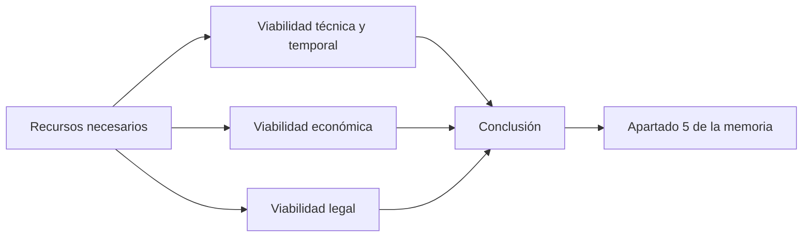

# Unidad 5 · Estudio de viabilidad

!!! abstract "Objetivo de la unidad"

    En esta unidad aprenderás a comprobar si tu proyecto se puede llevar a cabo de verdad y a redactar el apartado **5. Estudio de viabilidad y recursos** de la memoria.

    Al finalizar serás capaz de explicar:

    - Qué recursos necesita tu proyecto y cuáles te faltan.
    - Si es técnicamente posible con lo que sabes y tienes.
    - Si cabe en el tiempo disponible.
    - Cuánto cuesta y si compensa.
    - Qué normas legales le afectan.
    - Si el proyecto es viable, y bajo qué condiciones.

---

## Relación con la memoria

En las unidades anteriores definiste el proyecto (2), lo planificaste (3) y lo analizaste con el DAFO (4). Ahora respondes a una pregunta decisiva: **¿se puede hacer realmente?**

El apartado **5. Estudio de viabilidad y recursos** incluirá:

- 5.1. Recursos necesarios.
- 5.2. Viabilidad técnica y temporal.
- 5.3. Viabilidad económica.
- 5.4. Viabilidad legal.
- 5.5. Conclusión de viabilidad.

!!! success "¿Qué conseguirás al finalizar la unidad?"

    Tendrás un dictamen razonado de viabilidad, con datos y condiciones, que cierra el análisis de tu proyecto y está listo para incluir en tu memoria.

!!! note "Sobre el apartado «Recursos»"

    La estructura de la memoria que viste en la unidad 1 incluye un apartado de recursos. En esta unidad se trabaja junto al estudio de viabilidad, porque no se puede valorar la viabilidad sin saber qué recursos necesitas.

---

## Del proyecto al dictamen

---

## Actividad 0 · Antes de empezar

Reúne en un solo documento los apartados 2, 3 y 4 de tu memoria y comprueba que tienes lo necesario:

- [ ] Tengo mi lista de funcionalidades del MVP (apartado 2).
- [ ] Tengo mi tabla de tareas con horas y dependencias (apartado 3).
- [ ] Tengo mi matriz DAFO y mis acciones CAME (apartado 4).
- [ ] Sé cuántas horas totales he previsto, incluyendo las acciones CAME que añaden tareas.

!!! tip "Consejo"

    Casi todos los datos de esta unidad salen de lo que ya has escrito: horas de la unidad 3, debilidades y amenazas de la unidad 4. Si algo no cuadra, es mejor descubrirlo ahora.

---

## Lista de comprobación

- [ ] Sé qué es un estudio de viabilidad y para qué sirve.
- [ ] He hecho el inventario de los recursos que necesito.
- [ ] He comprobado si mi proyecto es viable técnicamente.
- [ ] He comparado las horas necesarias con las disponibles.
- [ ] He calculado el coste y el beneficio de mi proyecto.
- [ ] Conozco las normas legales que afectan a mi proyecto.
- [ ] Sé redactar una conclusión de viabilidad razonada.

---
