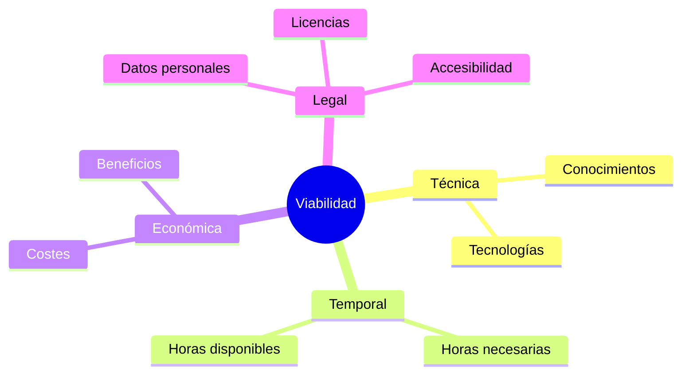

# Introducción

## Antes de empezar...

Imagina que quieres construir una casa. Tienes el plano (la definición), el calendario de obra (la planificación) y has pensado qué puede salir mal (el DAFO).

Pero aún te falta preguntarte: **¿tengo los materiales, el dinero, los permisos y el tiempo para construirla?**

Eso es un estudio de viabilidad.

---

## ¿Qué es un estudio de viabilidad?

Es un análisis que responde a una pregunta: **¿merece la pena y es posible llevar adelante este proyecto?**

!!! info "Idea clave"

    El estudio de viabilidad no sirve para justificar que el proyecto es bueno. Sirve para comprobar, con datos, si se puede hacer. Una conclusión honesta puede ser «sí, pero con estas condiciones».

---

## Tipos de viabilidad

| Tipo | Pregunta que responde |
|--------|--------|
| **Técnica** | ¿Se puede construir con las tecnologías y conocimientos que tengo? |
| **Temporal** | ¿Cabe en el tiempo disponible? |
| **Económica** | ¿Cuánto cuesta y compensa ese coste? |
| **Legal** | ¿Cumple las normas que le afectan? |

---

## Los recursos: el punto de partida

Antes de valorar la viabilidad hay que saber **qué se necesita**. Los recursos son todo aquello que el proyecto consume o utiliza:

- **Humanos:** personas y su tiempo.
- **Materiales:** equipos y dispositivos.
- **Software y servicios:** herramientas, alojamiento, dominio.
- **Información:** documentación y formación.

---

## Tres respuestas posibles

Un estudio de viabilidad puede terminar de tres maneras:

| Resultado | Significado | Qué se hace |
|--------|--------|--------|
| 🟢 **Viable** | No hay obstáculos importantes. | Se continúa con el plan. |
| 🟡 **Viable con condiciones** | Es posible si se cumplen ciertas medidas. | Se continúa aplicando las medidas. |
| 🔴 **No viable tal como está** | Hay un obstáculo serio. | Se ajusta el proyecto: menos alcance, otra tecnología... |

!!! warning "Error frecuente"

    Concluir siempre «viable» sin haber calculado nada. Un estudio sin cifras ni condiciones no demuestra nada.

---

## ¿Qué espera encontrar el lector?

### ¿Qué necesita el proyecto?
Una lista concreta de recursos, con su disponibilidad y coste.

### ¿Se ha comprobado con datos?
Horas necesarias frente a disponibles, costes frente a beneficios.

### ¿Se conocen las normas aplicables?
Se nombran las normas relevantes y las medidas que se toman.

### ¿Hay una conclusión razonada?
Un dictamen claro, con sus condiciones.

---

## Lo que aprenderás en esta unidad

1. Inventariar los recursos de tu proyecto.
2. Valorar su viabilidad técnica y temporal.
3. Calcular costes, beneficios y periodo de recuperación.
4. Identificar las normas legales que te afectan.
5. Redactar un dictamen de viabilidad.

---

## Lo que escribirás en tu memoria

- El inventario de recursos.
- Las comprobaciones técnicas y temporales.
- El cálculo económico.
- Las medidas legales.
- La conclusión de viabilidad.

---

## Para reflexionar

??? question "Piensa en tu proyecto"

    - ¿Hay algo imprescindible que ahora mismo no tengas?
    - ¿Qué parte técnica es la que más te preocupa?
    - ¿Qué pasaría si necesitaras un 30 % más de tiempo?
    - ¿Maneja tu proyecto datos de personas?

---

## Ideas clave

!!! success "Qué debes recordar"

    ✅ La viabilidad se comprueba con datos, no con opiniones.

    ✅ Hay cuatro dimensiones: técnica, temporal, económica y legal.

    ✅ «Viable con condiciones» es una conclusión válida y habitual.

    ✅ El estudio de viabilidad cierra el análisis y puede obligarte a ajustar el proyecto.
