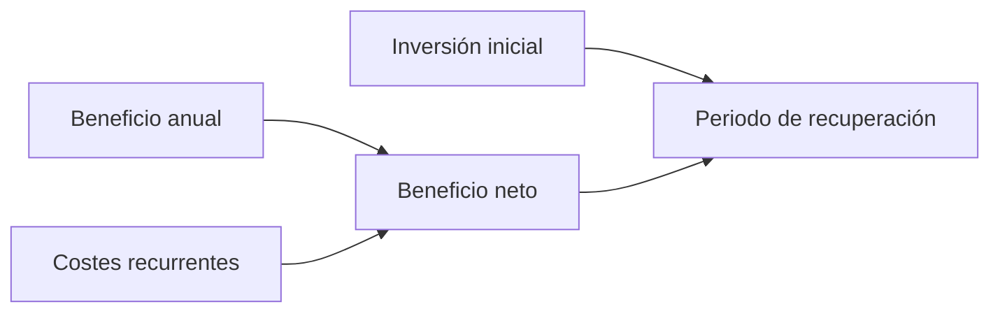

# Viabilidad económica

## ¿Qué se calcula?

La viabilidad económica responde a dos preguntas:

1. **¿Cuánto cuesta?** (inversión inicial y costes recurrentes).
2. **¿Compensa?** (cuánto ahorra o gana el proyecto frente a lo que cuesta).

!!! info "Idea clave"

    Un proyecto puede ser técnicamente perfecto y no ser viable porque cuesta más de lo que aporta.

---

## Paso 1 · Costes

### Inversión inicial

Lo que cuesta **crear** el proyecto, una sola vez.

| Concepto | Cómo se calcula |
|--------|--------|
| Mano de obra | Horas del proyecto × precio por hora. |
| Equipos | Amortización: precio del equipo ÷ meses de vida útil × meses de uso. |
| Software | Licencias de pago (0 € si es libre o gratuito). |

!!! tip "Tu trabajo también cuesta"

    Aunque tú no cobres, valora tus horas con un precio por hora razonable. Así se ve el coste real del proyecto. Indica que es una valoración simulada.

### Costes recurrentes

Lo que cuesta **mantener** el proyecto funcionando cada año: alojamiento, dominio, mantenimiento.

---

## Paso 2 · Beneficios

Según el tipo de proyecto, el beneficio puede ser:

| Tipo | Ejemplo |
|--------|--------|
| **Ingresos** | Cuotas de uso o suscripciones. |
| **Ahorro** | Menos horas de trabajo manual. |
| **Valor social** | Menos papel, mejor atención (difícil de cuantificar, pero se menciona). |

!!! warning "Error frecuente"

    Inventar beneficios sin explicar de dónde salen. Cada cifra debe apoyarse en un supuesto razonable: horas diarias, número de usuarios, precio por hora.

---

## Paso 3 · ¿Compensa?

### Periodo de recuperación

Es el tiempo que tarda el proyecto en devolver lo invertido.

```text
Periodo de recuperación = Inversión inicial ÷ Beneficio neto anual
Beneficio neto anual    = Beneficio anual − Costes recurrentes anuales
```

### Escenario prudente

Repite el cálculo con un beneficio **más bajo** (por ejemplo, la mitad). Si el proyecto sigue siendo razonable, la conclusión es más sólida.



---

## Caso práctico · ReservaSport

*Los datos son ilustrativos y se apoyan en supuestos que se indican.*

### Inversión inicial

| Concepto | Cálculo | Coste |
|--------|--------|:-----:|
| Mano de obra simulada | 125 h × 15 €/h | 1.875 € |
| Amortización del portátil | 800 € ÷ 48 meses × 2 meses | ≈ 33 € |
| Software | Libre o con plan gratuito | 0 € |
| **Total** | | **≈ 1.908 €** |

### Costes recurrentes anuales

| Concepto | Coste anual |
|--------|:-----:|
| Alojamiento (5 €/mes) | 60 € |
| Dominio | 12 € |
| **Total** | **72 €** |

### Beneficio (ahorro)

**Supuestos:** el personal administrativo dedica unos 90 minutos diarios a gestionar reservas por teléfono; con la aplicación se reducen a 30 minutos. El coste del personal es de 12 €/h y hay 220 días laborables al año.

| Concepto | Cálculo | Importe |
|--------|--------|:-----:|
| Ahorro anual | 1 h/día × 220 días × 12 €/h | 2.640 € |
| Beneficio neto anual | 2.640 € − 72 € | 2.568 € |

### Periodo de recuperación

| Escenario | Beneficio neto anual | Recuperación |
|--------|:-----:|:-----:|
| Base | 2.568 € | 1.908 ÷ 2.568 ≈ 0,74 años (**unos 9 meses**) |
| Prudente (ahorro a la mitad) | 1.248 € | 1.908 ÷ 1.248 ≈ 1,5 años (**unos 18 meses**) |

**Coste monetario real para el autor:** unos 105 € (amortización más el primer año de alojamiento y dominio).

**Conclusión económica:** viable. Incluso en el escenario prudente, la inversión se recupera en menos de dos años.

---

## Actividad 1 · Calcula la amortización

Un portátil cuesta 900 €, tiene una vida útil de 5 años y se usará 3 meses en el proyecto. ¿Cuánto se imputa al proyecto?

??? success "Solución orientativa"

    5 años = 60 meses. 900 ÷ 60 = 15 € al mes. Por 3 meses: 45 €.

---

## Actividad 2 · Periodo de recuperación

Un proyecto cuesta 2.400 € de inversión. Ahorra 1.800 € al año y tiene costes recurrentes de 200 € anuales.

1. ¿Cuál es el beneficio neto anual?
2. ¿Cuál es el periodo de recuperación?

??? success "Solución orientativa"

    1. 1.800 − 200 = 1.600 € al año.
    2. 2.400 ÷ 1.600 = 1,5 años (unos 18 meses).

---

## Actividad 3 · Una cifra sin base

Un alumno escribe: *«La aplicación ahorrará 10.000 € al año»*. ¿Qué le preguntarías?

??? success "Solución orientativa"

    ¿De dónde sale esa cifra? Habría que indicar cuántas personas usan la aplicación, cuánto tiempo ahorra cada una y cuánto cuesta esa hora. Sin esos supuestos, la cifra no tiene valor.

---

## Actividad 4 · Tu estudio económico

1. Calcula tu inversión inicial (mano de obra simulada, equipos y software).
2. Calcula tus costes recurrentes anuales.
3. Estima el beneficio (ahorro o ingresos) **explicando los supuestos**.
4. Calcula el periodo de recuperación en un escenario base y en uno prudente.
5. Redacta tu conclusión económica.

!!! note "Si tu proyecto no es rentable en dinero"

    Algunos proyectos tienen sobre todo valor social o educativo. En ese caso, calcula igualmente los costes y describe con claridad qué beneficio aporta, aunque no se mida en euros.

---

## Ejemplos de redacción para la memoria

| Nivel | Ejemplo |
|---------|---------|
| ❌ Pobre | El proyecto es barato y rentable. |
| ⚠️ Básico | El coste total es de unos 1.900 € y se recupera en poco tiempo. |
| ✅ Bueno | La inversión inicial es de 1.908 € y el ahorro anual es de 2.640 €, por lo que se recupera en unos 9 meses. |
| ⭐ Excelente | La inversión inicial es de 1.908 € y los costes anuales de 72 €. Con un ahorro estimado de una hora diaria de trabajo administrativo (2.640 € al año), la inversión se recupera en unos 9 meses. En un escenario prudente, con la mitad del ahorro, se recupera en unos 18 meses. |

---

## ¿Cómo aparecerá esto en la memoria?

### Plantilla reutilizable

```text
Viabilidad económica

Inversión inicial: [tabla de conceptos y costes]
Costes recurrentes anuales: [tabla]
Beneficios y supuestos: [explicación]

Periodo de recuperación:
- Escenario base: ...
- Escenario prudente: ...

Conclusión económica: ...
```

---

## Lo que irá a la memoria

```text
5.3. Viabilidad económica

- Inversión inicial.
- Costes recurrentes.
- Beneficios con sus supuestos.
- Periodo de recuperación (base y prudente).
- Conclusión económica.
```

---

## Autoevaluación

- [ ] He calculado la inversión inicial y los costes recurrentes.
- [ ] He valorado mi trabajo con un precio por hora simulado.
- [ ] Cada beneficio tiene un supuesto explicado.
- [ ] He calculado el periodo de recuperación.
- [ ] He incluido un escenario prudente.
- [ ] Podría redactar el apartado 5.3 de mi memoria.
