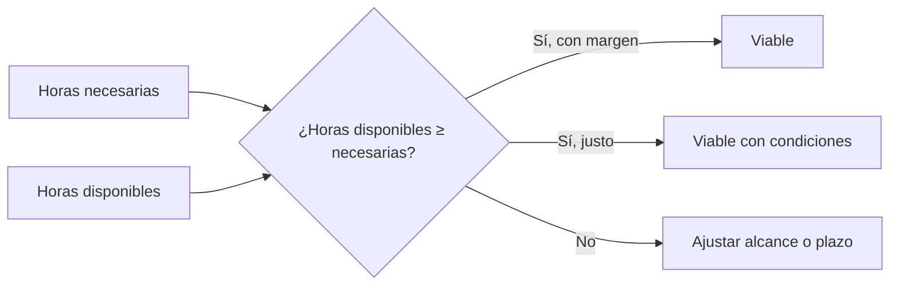

# Viabilidad técnica y temporal

## Dos preguntas, un mismo objetivo

| Dimensión | Pregunta |
|--------|--------|
| **Técnica** | ¿Sé hacerlo o puedo aprenderlo a tiempo con las herramientas que tengo? |
| **Temporal** | ¿Tengo horas suficientes para hacerlo? |

!!! info "Idea clave"

    La viabilidad técnica y la temporal están relacionadas: una tecnología desconocida cuesta más horas de lo que parece.

---

## Viabilidad técnica

### Cómo comprobarla

Para cada funcionalidad importante de tu MVP, revisa:

| Pregunta | Para qué sirve |
|--------|--------|
| ¿Qué tecnología lo resuelve? | Concretar la solución. |
| ¿La domino? | Detectar carencias. |
| ¿Existe una alternativa más sencilla? | Reducir el riesgo. |
| ¿Cómo lo comprobaré antes de empezar? | Prever una prueba de concepto. |

### Prueba de concepto

Una **prueba de concepto** es un prototipo mínimo que demuestra que algo técnicamente difícil es posible, antes de invertir en construirlo entero.

!!! tip "Conexión con el CAME"

    Si en el DAFO detectaste una debilidad técnica, la acción «corregir» suele ser una prueba de concepto. Ya tienes la mitad del trabajo hecho.

### Tabla de comprobación técnica

```text
| Funcionalidad | Tecnología | ¿La domino? | Riesgo | Qué haré |
|---------------|------------|-------------|--------|----------|
```

---

## Viabilidad temporal

### El cálculo básico

Compara dos cifras:

1. **Horas necesarias:** el total de tu tabla de tareas (unidad 3), más las acciones CAME que añadan trabajo.
2. **Horas disponibles:** los días laborables del cronograma por las horas diarias reales que puedes dedicar.



!!! warning "Error frecuente"

    Calcular las horas disponibles con un día ideal. Cuenta solo el tiempo que realmente puedes dedicar, descontando exámenes, otras asignaturas y días sin posibilidad de trabajar.

### El margen real

Resta las horas necesarias a las disponibles. El resultado es tu **margen real**. Compáralo con el margen que prometiste en la unidad 3.

---

## Caso práctico · ReservaSport

### Técnica

| Funcionalidad | Tecnología | ¿La domino? | Riesgo | Qué haré |
|--------|--------|--------|--------|--------|
| Registro e inicio de sesión | Lenguaje y framework del ciclo | Poca experiencia con sesiones | Medio | Prototipo previo (acción CAME) |
| Consulta de disponibilidad | Consultas SQL | Sí | Bajo | — |
| Evitar reservas duplicadas | Restricciones de la base de datos | Parcialmente | Medio | Prueba específica en las pruebas funcionales |
| Uso desde el móvil | Diseño adaptable | Sí | Bajo | Probar en un móvil real |

**Conclusión técnica:** viable, con un punto a vigilar: la gestión de sesiones.

### Temporal

| Concepto | Horas |
|--------|:-----:|
| Horas del plan (unidad 3) | 104 |
| Prototipo previo (acción CAME) | 6 |
| **Horas necesarias** | **110** |
| Horas disponibles (47 días laborables × 2,5 h/día) | ≈ 117 |
| **Margen real** | **≈ 7** |

El margen previsto en la unidad 3 era de unas 15 horas una vez descontado el prototipo. El margen real es **menor**.

**Conclusión temporal:** viable pero ajustado. Se acuerda revisar el avance cada semana y, si el margen se agota, simplificar la cancelación de reservas, que es la funcionalidad menos esencial.

---

## Actividad 1 · Calcula el margen

Un proyecto necesita 80 horas. El alumno dispone de 40 días laborables y puede dedicar 2 horas diarias.

1. ¿Cuántas horas tiene disponibles?
2. ¿Cuál es su margen real?
3. ¿Qué conclusión sacarías?

??? success "Solución orientativa"

    1. 40 × 2 = 80 horas disponibles.
    2. 80 − 80 = 0 horas de margen.
    3. No es viable sin ajustes: no hay margen para ningún imprevisto. Habría que reducir el alcance o ampliar el tiempo disponible.

---

## Actividad 2 · ¿Qué técnica es más arriesgada?

Una alumna debe implementar: (a) un formulario con campos de texto, (b) pagos online con tarjeta, (c) un listado con filtros. Nunca ha trabajado con pasarelas de pago.

¿Cuál es la más arriesgada y qué haría?

??? success "Solución orientativa"

    Los pagos online (b): no los domina, tienen implicaciones de seguridad y legales y es difícil estimar su coste. Podría dejarlos fuera del MVP o hacer antes una prueba de concepto muy acotada.

---

## Actividad 3 · Tu viabilidad técnica y temporal

1. Completa la tabla de comprobación técnica con las funcionalidades de tu MVP.
2. Calcula tus horas necesarias y disponibles.
3. Obtén tu margen real y compáralo con el previsto en la unidad 3.
4. Redacta una conclusión técnica y otra temporal.

---

## Ejemplos de redacción para la memoria

| Nivel | Ejemplo |
|---------|---------|
| ❌ Pobre | El proyecto es viable porque me gusta programar. |
| ⚠️ Básico | El proyecto es técnicamente viable y cabe en el tiempo disponible. |
| ✅ Bueno | Las tecnologías necesarias son conocidas, salvo la gestión de sesiones, y las horas necesarias (110) caben en las disponibles (117). |
| ⭐ Excelente | Las tecnologías son conocidas salvo la gestión de sesiones, que se aborda con una prueba de concepto previa. Las horas necesarias (110) caben en las disponibles (117), pero el margen real (7 horas) es inferior al previsto, por lo que se realizará seguimiento semanal y se simplificará la cancelación de reservas si fuese necesario. |

---

## ¿Cómo aparecerá esto en la memoria?

### Plantilla reutilizable

```text
Viabilidad técnica

[Tabla de comprobación técnica]

Conclusión técnica: ...

Viabilidad temporal

Horas necesarias: ...
Horas disponibles: ... (... días × ... horas diarias)
Margen real: ...

Conclusión temporal: ...
```

---

## Lo que irá a la memoria

```text
5.2. Viabilidad técnica y temporal

- Tabla de comprobación técnica.
- Cálculo de horas necesarias y disponibles.
- Margen real.
- Conclusión técnica y conclusión temporal.
```

---

## Autoevaluación

- [ ] He revisado la tecnología de cada funcionalidad importante.
- [ ] He previsto una prueba de concepto para lo más arriesgado.
- [ ] He calculado horas necesarias y disponibles con datos reales.
- [ ] He comparado mi margen real con el previsto.
- [ ] Podría redactar el apartado 5.2 de mi memoria.
