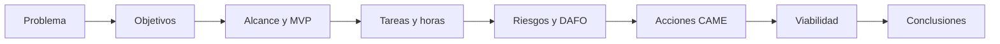

# Coherencia y revisión

## Por qué es la fase más importante

Los apartados que escribiste en unidades distintas ya no son independientes: ahora forman un solo documento. Si una cifra cambia, si una funcionalidad aparece con otro nombre o si un objetivo no tiene tareas, el lector lo nota... y desconfía.

!!! info "Idea clave"

    Revisar no es corregir faltas de ortografía. Es comprobar que **todo lo que dice la memoria encaja con todo lo demás**.

---

## La cadena de coherencia

Tu proyecto es una cadena. Cada eslabón debe apoyarse en el anterior.



### Qué comprobar en cada eslabón

| Comprobación | Dónde mirar | Fallo típico |
|--------|--------|--------|
| Cada objetivo tiene una funcionalidad | 2.2 y alcance | Un objetivo sin nada que lo cumpla. |
| Cada funcionalidad tiene tareas | Alcance y 3.2 | Una funcionalidad del MVP sin ninguna tarea. |
| Las horas coinciden | 3.3, 5.2 y 5.3 | 104 horas en un apartado y 120 en otro. |
| Los riesgos aparecen en el DAFO | 3.5 y 4 | Un riesgo grave que el DAFO ignora. |
| Las acciones CAME están en el plan | 4.4 y 3 | Una acción que añade horas pero no figura en las tareas. |
| La viabilidad usa los datos del plan | 5 y 3 | Costes calculados con otras horas. |
| Las conclusiones vuelven a los objetivos | 6 y 2.2 | Concluir cuatro objetivos cuando hay tres. |
| Los datos personales coinciden | 2, 5.4 | Se piden tres datos en un sitio y cinco en otro. |

---

## Coherencia de los términos

Usa **siempre la misma palabra** para el mismo concepto. Si en el apartado 2 hablas de «reservas», no pases a «citas» en el apartado 3.

!!! tip "Haz un pequeño glosario"

    Escribe en un borrador los nombres que has decidido: el de las funcionalidades, el del proyecto, el de los usuarios. Después busca en todo el documento las variantes y unifícalas.

---

## Revisión de la redacción

| Regla | Ejemplo |
|--------|--------|
| **Una idea por párrafo** | Si un párrafo habla de dos temas, sepáralo. |
| **Frases cortas** | Procura no superar unas 25 palabras por frase. |
| **Concreto antes que genérico** | «Reduce 1 hora diaria» mejor que «ahorra mucho tiempo». |
| **Sin relleno** | Quita «cabe destacar que», «como es sabido». |
| **Mismo estilo** | Misma persona y mismo tiempo verbal en todo el texto. |

### Técnicas que funcionan

- **Leer en voz alta.** Lo que suena raro suele estar mal escrito.
- **Dejar reposar un día** antes de la revisión final.
- **Pasar un corrector ortográfico** y revisar sus sugerencias, sin aceptarlas a ciegas.
- **Leer cada apartado como si no conocieras el proyecto.**

!!! warning "Error frecuente"

    Hacer una sola revisión. Conviene una de **contenido** (coherencia), otra de **redacción** y una última **formal** (formato, numeración, tablas).

---

## Revisión formal

- [ ] El índice coincide con los títulos reales.
- [ ] Las tablas y figuras tienen título y número.
- [ ] Los diagramas se ven correctamente.
- [ ] No hay marcas de «pendiente» o «borrador».
- [ ] Los enlaces funcionan.
- [ ] La portada tiene todos los datos.

!!! tip "Si publicas con MkDocs"

    Al ejecutar `mkdocs build` aparecen avisos sobre enlaces internos rotos. Revísalos antes de entregar.

---

## Actividad 1 · Caza de incoherencias

Lee este resumen de una memoria e indica todas las incoherencias:

> - **2.2:** el MVP incluye consultar disponibilidad, reservar, cancelar y enviar notificaciones por correo.
> - **3.2:** las tareas son: requisitos, base de datos, prototipo, usuarios, disponibilidad, reservas, cancelación, pruebas y documentación.
> - **3.3:** el total estimado es de 104 horas.
> - **5.2:** horas necesarias del plan: 120.
> - **5.4:** se recogen nombre, correo y teléfono.
> - **2.1:** los usuarios se identifican con su DNI.
> - **6:** «se han cumplido los cuatro objetivos» (el apartado 2.2 define tres).

??? success "Solución orientativa"

    - Las notificaciones por correo están en el MVP pero no hay ninguna tarea para ellas.
    - Las horas del plan son 104 en el apartado 3.3 y 120 en el 5.2.
    - El DNI aparece en el apartado 2.1 pero no se recoge en 5.4, y además no sería un dato imprescindible.
    - Las conclusiones hablan de cuatro objetivos y solo hay tres.

---

## Actividad 2 · Tu matriz de trazabilidad

Rellena una fila por cada objetivo de tu proyecto:

```text
| Objetivo | Funcionalidad | Tareas | Horas | Riesgo asociado | Resultado en conclusiones |
|----------|---------------|--------|-------|-----------------|---------------------------|
```

Si alguna celda queda vacía, hay un hueco en tu memoria que tienes que cerrar.

---

## Actividad 3 · Revisión cruzada

En parejas, intercambiad las memorias.

1. Lee el documento completo de tu compañero o compañera.
2. Rellena la lista de la cadena de coherencia con ejemplos concretos.
3. Anota **tres cosas que no has entendido** y **tres que funcionan bien**.
4. Entrégale tus notas y corrige tu memoria con las suyas.

!!! tip "Cómo dar feedback"

    Señala el problema y el lugar exacto («en 5.2 las horas no coinciden con 3.3»), sin juzgar a la persona.

---

## ¿Cómo aparecerá esto en la memoria?

Esta unidad no añade un apartado nuevo: **mejora todos los demás**. El resultado de la revisión se ve en que:

- Las cifras coinciden en todo el documento.
- Los términos son siempre los mismos.
- Cada objetivo se sigue hasta las conclusiones.

---

## Lo que irá a la memoria

```text
Todo el documento

- Coherencia entre apartados.
- Redacción revisada.
- Formato uniforme.
```

---

## Autoevaluación

- [ ] He comprobado la cadena de coherencia completa.
- [ ] Las cifras coinciden en todos los apartados.
- [ ] Uso siempre los mismos términos.
- [ ] He revisado contenido, redacción y formato por separado.
- [ ] He hecho y recibido una revisión cruzada.
