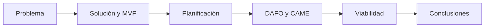

# La defensa oral

## ¿Qué es la defensa?

La defensa es la presentación oral de tu proyecto, seguida de preguntas. Su objetivo es demostrar que **entiendes tu propio trabajo** y que sabes explicarlo con claridad.

!!! info "Idea clave"

    En la defensa no se repite la memoria: se cuenta el proyecto. La memoria ya está entregada; la defensa demuestra que la has pensado tú.

La duración exacta y el formato los indicará tu profesor o profesora: **[duración y formato que se indiquen]**. En esta página trabajamos con un ejemplo de 7 minutos que puedes adaptar.

---

## Estructura de la presentación

| Parte | Qué cuentas | Tiempo |
|--------|--------|:-----:|
| **1. Problema** | Qué dificultad existe y para quién. | 1' |
| **2. Solución y MVP** | Qué propones y qué incluye la primera versión. | 1' 30" |
| **3. Planificación** | Fases, tareas, horas y cronograma. | 1' |
| **4. DAFO y CAME** | Los factores clave y las acciones que decides. | 1' |
| **5. Viabilidad** | Recursos, cifras y dictamen. | 1' 30" |
| **6. Conclusiones** | Qué has conseguido y qué harás en 2.º DAW. | 1' |



!!! tip "Cuenta una historia"

    Sigue el hilo de la memoria: *hay un problema → propongo esto → lo planifico así → estos son los riesgos → es viable → esto concluyo.* Quien te escucha debe poder seguirte sin leer nada.

---

## Las diapositivas

| Regla | Por qué |
|--------|--------|
| **Una idea por diapositiva** | El público no puede leer y escucharte a la vez. |
| **Poco texto** | Las diapositivas apoyan, no sustituyen, lo que dices. |
| **Imágenes y esquemas** | Un diagrama de Gantt o un cuadro semáforo comunican más que un párrafo. |
| **Entre 6 y 10 diapositivas** | Una por parte, más la portada. |
| **Datos clave visibles** | Horas, margen, coste y dictamen. |

!!! warning "Error frecuente"

    Leer las diapositivas en voz alta. Si lo que dices es lo mismo que está escrito, sobra una de las dos cosas.

### Qué enseñar de cada apartado

- **Solución:** el listado de funcionalidades del MVP.
- **Planificación:** el diagrama de Gantt con sus hitos.
- **DAFO y CAME:** la matriz y las acciones más importantes.
- **Viabilidad:** el cuadro resumen con las valoraciones y el dictamen.

---

## Cómo preparar el guion

1. **Escribe las ideas clave**, no el discurso completo. Memorizar un texto entero suena rígido y se olvida con los nervios.
2. **Prepara la primera frase** y la última. Son las que más cuestan.
3. **Cronometra** una vez completa y ajusta lo que sobre.
4. **Ensaya en voz alta**, mejor delante de alguien.

### Cómo comunicar

| Aspecto | Consejo |
|--------|--------|
| Voz | Alta y pausada. Hablamos más rápido cuando estamos nerviosos. |
| Mirada | Al público, no a la pantalla ni al papel. |
| Postura | Estable, de cara al público. |
| Pausas | Respira entre las partes. Ayudan a ti y a quien te escucha. |

---

## Las preguntas

Después de la presentación habrá preguntas. No son un examen sorpresa: casi todas salen de tu memoria.

### Preguntas habituales

| Tema | Ejemplos |
|--------|--------|
| **Alcance** | ¿Por qué has dejado esta funcionalidad fuera del MVP? |
| **Planificación** | ¿Cómo has estimado las horas? ¿Qué pasa si te retrasas? |
| **Riesgos** | ¿Cuál es la parte más arriesgada y qué has previsto? |
| **Viabilidad** | ¿Qué condiciones necesita tu proyecto para ser viable? |
| **Datos** | ¿Por qué recoges estos datos personales y no otros? |
| **Futuro** | ¿Qué harás primero en 2.º DAW? |

### Cómo responder

1. **Escucha** la pregunta completa. Si no la entiendes, pide que la repitan.
2. **Piensa** unos segundos antes de contestar.
3. **Responde a lo que te preguntan**, con una frase de entrada clara y un dato de tu memoria.
4. **Si no lo sabes, dilo**, y explica cómo lo averiguarías: *«No lo he contemplado; lo valoraría así...»*.

!!! tip "Tu mejor aliado"

    Conocer bien tu propia memoria. Las respuestas más sólidas empiezan con «según el apartado 5...» y acaban con un dato.

---

## Errores frecuentes

!!! warning "Evítalos"

    - Superar o quedarse muy lejos del tiempo asignado.
    - Leer la memoria o las diapositivas.
    - Dedicar casi todo el tiempo al problema y dejar la viabilidad para el último minuto.
    - Defender que todo es perfecto y evitar hablar de las limitaciones.
    - Responder con «es que...» en lugar de con un dato.

---

## Actividad 1 · Ordena el guion

Ordena estas ideas de una defensa:

Conclusiones · Viabilidad · Problema · Planificación · Solución y MVP · DAFO y CAME

??? success "Solución"

    Problema, Solución y MVP, Planificación, DAFO y CAME, Viabilidad, Conclusiones.

---

## Actividad 2 · Mini-pitch de 60 segundos

Antes de hacer la presentación completa, resume tu proyecto en **un minuto**:

1. Un problema (1 frase).
2. Tu propuesta (1 frase).
3. Qué incluye el MVP (1 frase).
4. Por qué es viable (1 frase).

Cuéntaselo a un compañero. Si no lo entiende a la primera, simplifica.

---

## Actividad 3 · Ensayo cronometrado

En parejas:

1. Presenta tu proyecto completo ante tu pareja, con el tiempo asignado.
2. Tu pareja anota el tiempo real, qué ha entendido bien y qué no.
3. Cambiad los papeles.
4. Con las notas, ajusta tu guion y tus diapositivas.

---

## Actividad 4 · Prepara tus respuestas

1. Escribe **cinco preguntas** que crees que te harán, sacadas de los puntos débiles de tu memoria.
2. Redacta una respuesta breve a cada una, con un dato.
3. Pide a otra persona que te las haga en orden distinto y practica.

---

## Rúbrica orientativa de la defensa

- [ ] Se entiende el problema y la propuesta.
- [ ] La presentación sigue un orden lógico y respeta el tiempo.
- [ ] Las diapositivas son claras y apoyan lo que se dice.
- [ ] Se muestran los datos clave (horas, margen, coste, dictamen).
- [ ] Se explican las limitaciones con honestidad.
- [ ] Las respuestas son precisas y se apoyan en la memoria.
- [ ] La comunicación es clara: voz, ritmo y mirada.

!!! note "Valoración"

    Tu profesor o profesora concretará los criterios y su ponderación.

---

## Plantilla de guion

```text
Diapositiva 1. Portada: título y autoría.
Diapositiva 2. Problema: [frase clave].
Diapositiva 3. Solución y MVP: [frases clave].
Diapositiva 4. Planificación: [frases clave + Gantt].
Diapositiva 5. DAFO y CAME: [frases clave + matriz].
Diapositiva 6. Viabilidad: [frases clave + cuadro resumen].
Diapositiva 7. Conclusiones: [frases clave].

Primera frase: ...
Última frase: ...
```

---

## Autoevaluación

- [ ] Mi presentación sigue el hilo de la memoria.
- [ ] Mi presentación cabe en el tiempo asignado.
- [ ] Mis diapositivas tienen poco texto y esquemas claros.
- [ ] He ensayado en voz alta y cronometrado.
- [ ] Tengo preparadas respuestas a las preguntas más probables.
