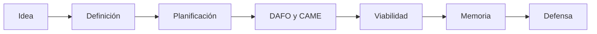

# Ejemplo completo · ReservaSport

En las unidades anteriores viste cada apartado de ReservaSport por separado. Aquí aparece **la memoria completa vista como un todo**: la portada y el resumen, la cadena de coherencia, el guion de la defensa y algunas respuestas a posibles preguntas. Úsalo como referencia, no como molde.

---

## Portada y resumen

```text
ReservaSport
Gestión de reservas de instalaciones deportivas

Autoría: [Nombre y apellidos]
Ciclo formativo: Desarrollo de Aplicaciones Web (1.º DAW)
Módulo: Proyecto Intermodular I
Fecha: [fecha]
```

**Resumen**

> ReservaSport es una aplicación web para gestionar las reservas de instalaciones deportivas pequeñas, que hoy se gestionan por teléfono o en papel. La primera versión (MVP) permite consultar la disponibilidad, realizar reservas y cancelarlas. El proyecto se ha planificado en 104 horas, a las que se añade un margen para imprevistos, y se ha analizado con un DAFO y un plan de acción. El estudio de viabilidad concluye que es viable con condiciones: un prototipo previo de inicio de sesión, seguimiento semanal del margen y recogida mínima de datos personales. En 2.º DAW se implementará el MVP según el plan.

---

## Índice

```text
1. Introducción
2. Definición del proyecto
3. Planificación temporal
4. Análisis DAFO y CAME
5. Estudio de viabilidad y recursos
6. Conclusiones
7. Bibliografía
```

---

## La cadena de coherencia de ReservaSport

| Eslabón | Contenido | Apartado |
|--------|--------|:--:|
| **Problema** | Reservas por teléfono o papel: pérdida de tiempo y reservas duplicadas. | 2.1 |
| **Objetivos** | Tres: consultar disponibilidad, reservar y cancelar. | 2.2 |
| **MVP** | Las tres funcionalidades, con tres perfiles de usuario. | 2.2 |
| **Tareas y horas** | Nueve tareas, 104 horas, más 6 del prototipo previo. | 3.2 y 3.3 |
| **Riesgos y DAFO** | Una tarea puede tardar el doble; poca experiencia y poco tiempo diario. | 3.5 y 4.1 |
| **CAME** | Prototipo previo, datos mínimos, alcance cerrado y entrevistas. | 4.4 |
| **Viabilidad** | Viable con condiciones; margen real de unas 7 horas; recuperación en unos 9 meses. | 5.5 |
| **Conclusiones** | Tres objetivos cumplidos; trabajo futuro para 2.º DAW. | 6 |

!!! success "Qué hace bien este ejemplo"

    ✅ Cada dato aparece con el mismo valor en todos los apartados.

    ✅ Cada objetivo se puede seguir hasta las conclusiones.

    ✅ Las acciones CAME se reflejan en el plan y en la viabilidad.

    ✅ La introducción y las conclusiones se redactaron al final.

---

## Guion de defensa de 7 minutos

| Diapositiva | Contenido | Tiempo |
|--------|--------|:-----:|
| 1. Portada | Título y autoría. | — |
| 2. Problema | Reservas por teléfono: tiempo perdido y reservas duplicadas. | 1' |
| 3. Solución y MVP | ReservaSport y sus tres funcionalidades esenciales. | 1' 30" |
| 4. Planificación | Diagrama de Gantt: nueve semanas y el hito de entrega. | 1' |
| 5. DAFO y CAME | Matriz y las cuatro acciones elegidas. | 1' |
| 6. Viabilidad | Cuadro semáforo y dictamen «viable con condiciones». | 1' 30" |
| 7. Conclusiones | Objetivos cumplidos, limitaciones y primeros pasos en 2.º DAW. | 1' |

**Primera frase:** *«¿Cuánto tiempo pierde al día una instalación deportiva pequeña gestionando reservas por teléfono?»*

**Última frase:** *«ReservaSport es viable si cumplimos tres condiciones, y el plan para cumplirlas ya está escrito.»*

---

## Preguntas y respuestas de ejemplo

**¿Por qué has dejado fuera las notificaciones por correo?**

> Porque no son imprescindibles para resolver el problema principal, que es consultar, reservar y cancelar, y porque añadirían horas que mi margen real no permite. Están anotadas como mejora futura.

**¿Qué pasa si te retrasas?**

> El margen real es de unas 7 horas. Reviso el avance cada semana con un tablero Kanban y, si el margen baja de 3 horas, simplifico la cancelación de reservas, que es la funcionalidad menos esencial.

**¿Por qué recoges solo nombre, correo y teléfono?**

> Por el principio de minimización: solo pido los datos que necesito para identificar al usuario y avisarle. Así reduzco el riesgo y las obligaciones legales.

**¿Cuál es la parte más arriesgada?**

> La gestión de sesiones, porque tengo poca experiencia. Por eso el plan incluye un prototipo previo de inicio de sesión antes de empezar el desarrollo.

!!! tip "Observa las respuestas"

    Todas empiezan con una respuesta clara, incluyen un dato de la memoria y terminan con una decisión ya tomada.

---

## Entregable final del módulo

!!! abstract "Actividad final · Memoria completa y defensa"

    Entrega la **memoria completa** de tu proyecto con la estructura definitiva y defiéndela oralmente.

### Qué debes entregar

- Memoria completa con portada, índice y los apartados 1 a 7.
- Declaración de herramientas utilizadas.
- Presentación de apoyo para la defensa.

### Criterios de evaluación de la memoria

- [ ] Está completa y sigue la estructura definitiva.
- [ ] Es coherente: cifras y términos coinciden en todos los apartados.
- [ ] La introducción presenta el problema, la propuesta y el alcance.
- [ ] Las conclusiones vuelven a los objetivos y reconocen limitaciones.
- [ ] La viabilidad se apoya en datos y tiene dictamen razonado.
- [ ] Las fuentes están citadas y las herramientas declaradas.
- [ ] La redacción es clara y el formato es cuidado.
- [ ] El trabajo es propio: no es una copia adaptada del ejemplo.

!!! note "Valoración"

    Tu profesor o profesora concretará la ponderación de cada criterio y los de la defensa.

### Lista de comprobación antes de entregar

- [ ] He releído la memoria completa de principio a fin.
- [ ] Las cifras coinciden en todos los apartados.
- [ ] No quedan marcas de «pendiente» ni de «borrador».
- [ ] El índice y la numeración son correctos.
- [ ] Los diagramas y las tablas se ven bien en el archivo final.
- [ ] La bibliografía recoge solo fuentes que he consultado.
- [ ] El archivo tiene el formato y el nombre que se me pidió.
- [ ] He entregado antes de la fecha límite.

!!! warning "Importante"

    ReservaSport es una referencia. Una memoria que reproduce sus datos con otro nombre no demuestra que hayas analizado **tu** proyecto.

---

## Resumen de la unidad

!!! success "Qué debes recordar"

    ✅ La memoria es un único relato coherente, no una suma de apartados.

    ✅ La introducción y las conclusiones se escriben al final.

    ✅ Revisar es comprobar que todo encaja: cifras, términos y objetivos.

    ✅ Citar fuentes y declarar herramientas forma parte del trabajo.

    ✅ En la defensa se cuenta el proyecto con datos, no se lee la memoria.

---

## Qué has conseguido en este módulo

Has recorrido todo el camino de una idea a un proyecto documentado:



Ahora sabes **identificar un problema, definirlo, planificarlo, analizarlo, comprobar su viabilidad y defenderlo**. Es exactamente la forma de pensar de un profesional antes de escribir una sola línea de código.

---

## Próximos pasos: 2.º DAW

En 2.º DAW pasarás de la memoria a la aplicación: **implementar, probar y desplegar**. La memoria que acabas de terminar es tu hoja de ruta: tiene el alcance, las tareas, las estimaciones, los riesgos y las condiciones de viabilidad.

!!! tip "Cuídala"

    Guarda tu memoria y tu repositorio. En 2.º DAW los volverás a abrir el primer día.
