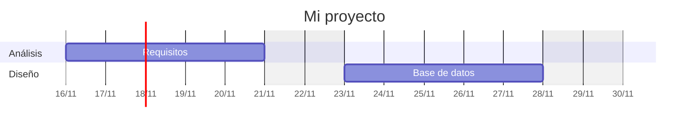
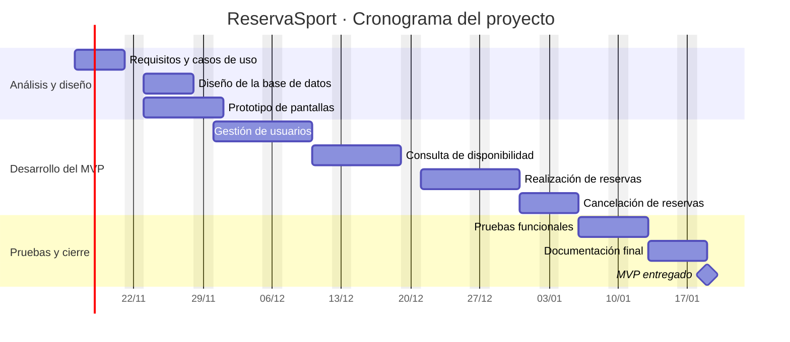
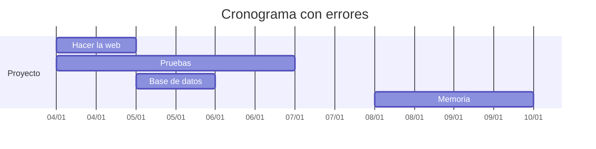

# Cronograma

## ¿Qué es un cronograma?

Un cronograma es la representación del plan sobre un calendario: qué tarea empieza, cuándo termina y qué tareas se solapan.

El tipo de cronograma más habitual es el **diagrama de Gantt**.

!!! info "Idea clave"

    El Gantt muestra de un vistazo el orden, la duración y los solapamientos de las tareas.

---

## Gantt 



## Del horas a los días

La estimación está en horas, pero el cronograma está en días. Para convertir, piensa cuántas horas reales puedes dedicar cada día.

!!! example "Ejemplo"

    Una tarea de 16 horas con una dedicación media de 2-3 horas al día ocupa unos 6-8 días laborables.

---

## Caso práctico · ReservaSport



!!! note "Fechas orientativas"

    Las fechas del ejemplo son ilustrativas. En tu cronograma usa las fechas que correspondan a tu calendario.

---

## Un buen cronograma

✅ Cada tarea tiene una duración razonable.

✅ Se respetan las dependencias.

✅ Hay hitos visibles.

✅ El trabajo está repartido, no concentrado al final.

✅ Incluye la documentación y las pruebas.

✅ Deja margen antes de la fecha límite.

---

## Actividad 1 · Caza de errores

Este cronograma tiene varios problemas. Encuéntralos.



??? success "Solución orientativa"

    - «Hacer la web» es una tarea vaga, y 1 día es poco para algo tan grande.
    - Las pruebas empiezan a la vez que el desarrollo, antes de que haya nada que probar.
    - La base de datos se diseña después de empezar a «hacer la web»: debería ir antes.
    - No hay fase de análisis ni de documentación.
    - Toda la memoria se deja para el final, en solo 2 días.
    - No hay hitos ni margen.

---

## Actividad 2 · Corrige el cronograma

Reescribe el cronograma de la actividad anterior solucionando los errores. Escríbelo en Mermaid.

??? success "Orientación"

    Un buen resultado separa el análisis, el diseño de la base de datos, varias tareas de desarrollo con `after`, pruebas posteriores al desarrollo, documentación repartida y un hito final.

---

## Actividad 3 · Tu Gantt

1. Toma la tabla de tareas con horas y dependencias de la unidad anterior.
2. Convierte las horas a días según tu dedicación.
3. Escribe tu diagrama en Mermaid usando `after` para las dependencias.
4. Añade al menos un hito.
5. Comprueba que se dibuja correctamente en la web (`mkdocs serve`).

!!! tip "Si el diagrama no aparece"

    Revisa la indentación, que cada línea de tarea tenga `:` y que los identificadores no se repitan.

---

## Ejemplos de redacción para la memoria

| Nivel | Ejemplo |
|---------|---------|
| ❌ Pobre | El proyecto se hará en pocos meses. |
| ⚠️ Básico | Se adjunta un cronograma del proyecto. |
| ✅ Bueno | El cronograma muestra las fases del proyecto con sus tareas, fechas de inicio y de fin. |
| ⭐ Excelente | El cronograma muestra las tareas agrupadas por fase, con sus dependencias y el hito de entrega del MVP. Las tareas de diseño se realizan en paralelo y las pruebas se programan al terminar el desarrollo. |

---

## ¿Cómo aparecerá esto en la memoria?

### Plantilla reutilizable

```text
La planificación temporal del proyecto se representa en el siguiente cronograma:

[Diagrama de Gantt]

El proyecto comienza el ... y finaliza el ...

Los hitos principales son...

Las tareas que pueden realizarse en paralelo son...
```

### Ejemplo

> El cronograma de ReservaSport se extiende a lo largo de nueve semanas e incluye cuatro bloques: análisis, diseño, desarrollo y pruebas. El hito final es la entrega del MVP documentado.

---

## Lo que irá a la memoria

```text
3.4. Cronograma

- Diagrama de Gantt.
- Fechas de inicio y fin.
- Hitos.
- Explicación breve del orden elegido.
```

---

## Autoevaluación

- [ ] Sé leer un diagrama de Gantt.
- [ ] He escrito mi Gantt en Mermaid.
- [ ] Mi cronograma respeta las dependencias.
- [ ] Incluye hitos y documentación.
- [ ] Hay margen antes de la fecha límite.
- [ ] Podría redactar el apartado 3.4 de mi memoria.
EOF