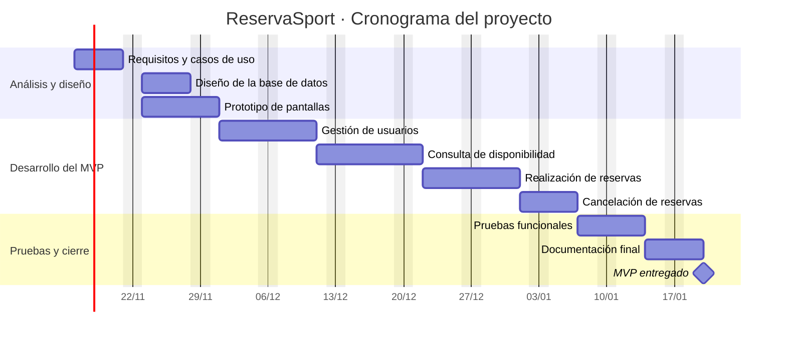

# Ejemplo completo · ReservaSport

Este es el apartado **3. Planificación temporal** completo del proyecto de ejemplo ReservaSport, tal y como podría aparecer en una memoria. Úsalo como referencia, no como molde: tu proyecto tendrá sus propias fases, tareas y riesgos.

---

## 3. Planificación temporal

### 3.1. Fases del proyecto

El proyecto se divide en cinco fases secuenciales. Cada una termina con un resultado comprobable, lo que permite detectar desviaciones de forma temprana.

| Fase | Contenido | Resultado |
|--------|--------|--------|
| Análisis | Requisitos y casos de uso de ciudadano, administrativo y administrador. | Lista de requisitos. |
| Diseño | Modelo de datos y prototipo de pantallas. | Modelo de datos y bocetos. |
| Desarrollo | Usuarios, disponibilidad, reservas y cancelaciones. | MVP funcionando. |
| Pruebas | Pruebas funcionales de reservas y cancelaciones. | Registro de pruebas. |
| Entrega | Documentación y cierre. | MVP entregado y documentado. |

---

### 3.2. Tareas e hitos

Las tareas se derivan directamente de las funcionalidades del MVP definido en el apartado 2.

| Código | Fase | Tarea |
|-------|--------|--------|
| T1 | Análisis | Redactar requisitos y casos de uso |
| T2 | Diseño | Diseñar la base de datos |
| T3 | Diseño | Diseñar el prototipo de pantallas |
| T4 | Desarrollo | Programar la gestión de usuarios |
| T5 | Desarrollo | Programar la consulta de disponibilidad |
| T6 | Desarrollo | Programar la realización de reservas |
| T7 | Desarrollo | Programar la cancelación de reservas |
| T8 | Pruebas | Realizar pruebas funcionales |
| T9 | Entrega | Redactar la documentación final |

**Hitos del proyecto**

- **H1.** Requisitos cerrados (fin de T1).
- **H2.** Diseño completado (fin de T2 y T3).
- **H3.** Primera funcionalidad completa: consulta de disponibilidad (fin de T5).
- **H4.** MVP funcionando (fin de T7).
- **H5.** MVP entregado y documentado (fin de T9).

---

### 3.3. Estimación de tiempos y dependencias

| Código | Tarea | Horas | Depende de |
|-------|--------|:-----:|--------|
| T1 | Redactar requisitos y casos de uso | 10 | — |
| T2 | Diseñar la base de datos | 10 | T1 |
| T3 | Diseñar el prototipo de pantallas | 12 | T1 |
| T4 | Programar la gestión de usuarios | 16 | T2, T3 |
| T5 | Programar la consulta de disponibilidad | 14 | T4 |
| T6 | Programar la realización de reservas | 16 | T5 |
| T7 | Programar la cancelación de reservas | 8 | T6 |
| T8 | Realizar pruebas funcionales | 10 | T7 |
| T9 | Redactar la documentación final | 8 | T8 |
| | **Total** | **104** | |

Se estima una dedicación total de 104 horas, a las que se añade un margen del 20 % para imprevistos, por lo que el total previsto es de aproximadamente 125 horas. Las estimaciones se contrastaron por parejas. Las tareas T2 y T3 pueden realizarse en paralelo, ya que ambas dependen únicamente de T1.

---

### 3.4. Cronograma



El cronograma se extiende a lo largo de unas nueve semanas, con una dedicación media de 2 a 3 horas por día laborable. La documentación final se redacta al terminar las pruebas, pero se va recopilando durante todo el desarrollo.

---

### 3.5. Seguimiento y riesgos del calendario

El seguimiento se realizará con un tablero Kanban en GitHub Projects, con las columnas *Por hacer*, *En curso* y *Hecho*, que se revisará una vez por semana.

| Riesgo | Probabilidad | Impacto | Qué hacer |
|--------|:------:|:------:|--------|
| Una tarea tarda el doble de lo previsto | Alta | Alto | Usar el margen del 20 % y revisar estimaciones cada semana. |
| Ausencia de varios días | Media | Medio | Mantener una semana libre antes de la entrega. |
| Ampliación del alcance a mitad del proyecto | Media | Alto | Mantener el alcance definido en el apartado 2.2. |
| Error en una tarea que bloquea a las siguientes | Media | Alto | Comprobar cada tarea al terminarla. |

En caso de retraso se utilizará primero el margen previsto y, si no es suficiente, se simplificarán las funcionalidades secundarias, como la cancelación de reservas, sin modificar las esenciales.

---

## ¿Qué hace bien este ejemplo?

✅ Parte del MVP de la unidad 2: cada tarea responde a una funcionalidad.

✅ Las fases terminan en resultados comprobables.

✅ Las estimaciones tienen margen y dependencias.

✅ El cronograma respeta las dependencias y tiene un hito final.

✅ Los riesgos tienen una medida asociada.

✅ Incluye un plan de actuación ante retrasos.

---

## Plantilla rápida del apartado 3

```text
3. Planificación temporal

3.1. Fases del proyecto
[Tabla de fases con su resultado]

3.2. Tareas e hitos
[Tabla de tareas por fase + lista de hitos]

3.3. Estimación de tiempos y dependencias
[Tabla con horas y dependencias + margen y total]

3.4. Cronograma
[Diagrama de Gantt + breve explicación]

3.5. Seguimiento y riesgos del calendario
[Herramienta, frecuencia, tabla de riesgos, plan ante retrasos]
```

---

## Entregable de la unidad

!!! abstract "Actividad final · Apartado 3 de tu memoria"

    Redacta el apartado **3. Planificación temporal** de tu proyecto, con las cinco secciones (3.1 a 3.5), a partir del MVP que definiste en la unidad 2.

### Qué debes entregar

- Texto del apartado 3 completo, en Markdown.
- Tabla de tareas con horas y dependencias.
- Diagrama de Gantt escrito en Mermaid.
- Captura de tu tablero Kanban.

### Criterios de evaluación

- [ ] Las fases terminan en un resultado comprobable.
- [ ] Las tareas son concretas y derivan del MVP.
- [ ] Las estimaciones tienen margen y están justificadas.
- [ ] Las dependencias son coherentes y no hay ciclos.
- [ ] El cronograma se dibuja correctamente y tiene hitos.
- [ ] Los riesgos son concretos y tienen medidas asociadas.
- [ ] El texto está bien redactado, sin copiar el ejemplo.

!!! warning "Importante"

    El ejemplo de ReservaSport es una referencia. Si tu entrega es una copia adaptada con otro nombre, no estarás demostrando que has planificado **tu** proyecto.

---

## Resumen de la unidad

!!! success "Qué debes recordar"

    ✅ Planificar es decidir qué, en qué orden, cuánto y cuándo.

    ✅ Las fases dividen el proyecto; las tareas, las fases; los hitos marcan los puntos de control.

    ✅ Estima en horas, añade margen y detecta dependencias.

    ✅ El Gantt muestra el plan sobre el calendario.

    ✅ Un plan se revisa y se ajusta; los riesgos se anticipan.

---

## Próximos pasos

En la **Unidad 4** analizarás las debilidades, amenazas, fortalezas y oportunidades de tu proyecto con el DAFO y el CAME. Los riesgos del calendario que has identificado aquí serán un buen punto de partida.
