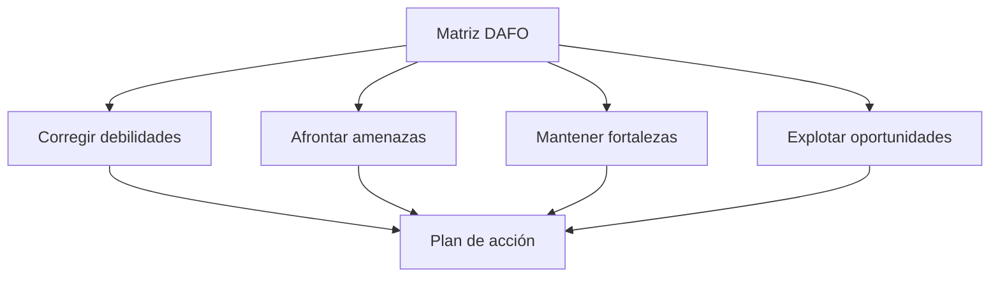

# Estrategias CAME

## Del análisis a las decisiones

El DAFO te dice dónde estás. El **CAME** te dice qué vas a hacer al respecto.

| Letra | Acción | Qué haces |
|--------|--------|--------|
| **C** | **Corregir** las debilidades | Reduces o eliminas lo que te limita. |
| **A** | **Afrontar** las amenazas | Te preparas para lo que puede perjudicarte. |
| **M** | **Mantener** las fortalezas | Proteges lo que ya te funciona. |
| **E** | **Explotar** las oportunidades | Aprovechas lo que el entorno te ofrece. |



!!! info "Idea clave"

    Cada acción CAME responde a un factor concreto del DAFO. Si no puedes decir a cuál, la acción sobra.

---

## Cómo redactar una buena acción

Una buena acción responde a cuatro preguntas:

| Pregunta | Ejemplo |
|--------|--------|
| ¿Qué voy a hacer? | Limitar los datos personales a nombre, correo y teléfono. |
| ¿Cuándo? | Durante el diseño de la base de datos (T2). |
| ¿Quién? | Yo mismo o misma. |
| ¿Cómo sabré que está hecha? | Tengo una lista de campos con su justificación. |

### Buena y mala acción

| ❌ Pobre | ✅ Mejor |
|--------|--------|
| Mejorar mi nivel técnico. | Dedicar la primera semana de desarrollo a un prototipo con inicio de sesión y una consulta a la base de datos. |
| Cuidar los datos. | Recoger solo nombre, correo y teléfono, y justificar cada campo. |

!!! warning "Error frecuente"

    Acciones vagas que no se pueden comprobar. Si no sabes cómo reconocer que una acción está hecha, aún no es una acción.

---

## Prioriza: menos acciones, pero hechas

No puedes hacerlo todo. Elige **entre 4 y 8 acciones**, como máximo dos por tipo, atendiendo a dos criterios:

| Criterio | Pregunta |
|--------|--------|
| Impacto | ¿Cuánto mejora mi proyecto? |
| Esfuerzo | ¿Cuánto tiempo me cuesta realmente? |

!!! tip "Regla práctica"

    Empieza por las acciones de **alto impacto y poco esfuerzo**. Descarta las de alto esfuerzo y poco impacto.

---

## Conecta el CAME con tu planificación

Las acciones consumen tiempo. Si eliges una acción de cierta envergadura, debes reflejarla en el plan de la unidad 3:

- Si es una tarea nueva, añádela a tu tabla de tareas con sus horas.
- Si afecta a una tarea existente, ajusta su descripción o su estimación.
- Si responde a un riesgo, actualiza la tabla de riesgos.

!!! note "Coherencia"

    Un DAFO que propone acciones imposibles de encajar en tu calendario deja en evidencia un plan que no ha sido revisado.

---

## Caso práctico · ReservaSport

| Tipo | Factor | Acción | Cuándo | Cómo sabré que está hecha |
|--------|--------|--------|--------|--------|
| **C**orregir | D1. Poca experiencia | Hacer un prototipo con login y una consulta antes de empezar el desarrollo. | Antes de T4 | Prototipo funcionando. |
| **A**frontar | A2. Normativa de datos | Recoger solo nombre, correo y teléfono, justificando cada campo. | En T2 | Lista de campos justificada. |
| **M**antener | F1. Alcance acotado | No añadir funcionalidades fuera del MVP. | Todo el proyecto | Ninguna tarea fuera del alcance. |
| **E**xplotar | O1. Reserva por teléfono | Entrevistar a dos instalaciones pequeñas para validar los requisitos. | En T1 | Dos entrevistas realizadas. |

---

## Actividad 1 · Convierte el factor en acción

Escribe una acción CAME concreta para cada factor:

1. D: «No sé usar sesiones de usuario».
2. A: «Existe una aplicación gratuita parecida».
3. F: «Mi alcance es pequeño y claro».
4. O: «Hay tutoriales gratuitos de calidad».

??? success "Solución orientativa"

    1. **Corregir:** dedicar un día a un pequeño ejercicio de inicio de sesión antes de la tarea de usuarios.
    2. **Afrontar:** analizar esa aplicación y definir qué haré distinto, para justificarlo en la memoria.
    3. **Mantener:** rechazar toda funcionalidad nueva hasta terminar el MVP.
    4. **Explotar:** elegir un tutorial y seguirlo para la gestión de usuarios.

---

## Actividad 2 · ¿Es una buena acción?

Valora cada acción: ¿es concreta, realista y comprobable?

1. «Aprender todo lo necesario».
2. «Entrevistar a dos posibles usuarios durante la fase de análisis».
3. «Superar a la competencia».

??? success "Solución orientativa"

    1. No: vaga, sin plazo ni criterio de finalización.
    2. Sí: concreta, tiene plazo y se puede comprobar.
    3. No: no está al alcance de un proyecto de este tamaño ni se puede comprobar.

---

## Actividad 3 · Tu plan de acción

1. Parte de tu matriz DAFO y de tus cruces.
2. Elige entre 4 y 8 acciones, priorizando por impacto y esfuerzo.
3. Rellena la tabla.
4. Actualiza tu plan de la unidad 3 si alguna acción añade o modifica tareas.

```text
| Tipo | Factor | Acción | Cuándo | Cómo sabré que está hecha |
|------|--------|--------|--------|---------------------------|
|      |        |        |        |                           |
```

---

## Ejemplos de redacción para la memoria

| Nivel | Ejemplo |
|---------|---------|
| ❌ Pobre | Se intentará mejorar y aprovechar todo lo posible. |
| ⚠️ Básico | Se corregirán las debilidades y se aprovecharán las oportunidades. |
| ✅ Bueno | Para corregir la falta de experiencia se realizará un prototipo previo al desarrollo. |
| ⭐ Excelente | Para corregir la falta de experiencia técnica (D1) se realizará, antes de la tarea T4, un prototipo con inicio de sesión y una consulta a la base de datos. La acción se ha incorporado al plan como tarea adicional de 6 horas y se considerará cumplida cuando el prototipo funcione. |

---

## ¿Cómo aparecerá esto en la memoria?

### Plantilla reutilizable

```text
A partir del análisis DAFO se establecen las siguientes acciones:

[Tabla: tipo, factor, acción, cuándo, indicador]

Estas acciones se han incorporado al plan de trabajo mediante...
```

### Ejemplo

> A partir del análisis se plantean cuatro acciones: un prototipo previo para corregir la falta de experiencia, una recogida mínima de datos para afrontar la normativa, el mantenimiento del alcance del MVP y entrevistas a dos instalaciones para aprovechar el interés por digitalizar las reservas.

---

## Lo que irá a la memoria

```text
4.4. Estrategias y plan de acción (CAME)

- Tabla de acciones C, A, M y E.
- Prioridad elegida y por qué.
- Cómo se reflejan en la planificación.
```

---

## Autoevaluación

- [ ] Sé qué significa cada letra del CAME.
- [ ] Cada acción responde a un factor concreto del DAFO.
- [ ] Mis acciones son concretas y comprobables.
- [ ] He priorizado entre 4 y 8 acciones.
- [ ] He reflejado las acciones importantes en mi planificación.
- [ ] Podría redactar el apartado 4.4 de mi memoria.
