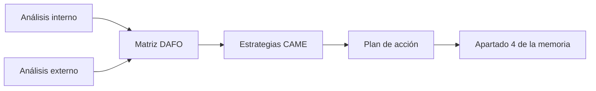

# Unidad 4 · Análisis DAFO y CAME

!!! abstract "Objetivo de la unidad"

    En esta unidad aprenderás a analizar tu proyecto con una mirada crítica y a redactar el apartado **4. Análisis DAFO y CAME** de la memoria.

    Al finalizar serás capaz de explicar:

    - Qué puntos fuertes y débiles tiene tu proyecto.
    - Qué oportunidades y amenazas hay en su entorno.
    - Cómo cruzar esa información en una matriz DAFO.
    - Qué acciones concretas tomarás a partir del análisis (CAME).

---

## Relación con la memoria

En la unidad 2 definiste **qué** vas a hacer y en la unidad 3 **cuándo**. En esta unidad te preguntas: **¿en qué condiciones lo voy a hacer y qué decisiones tomo a partir de ahí?**

El apartado **4. Análisis DAFO y CAME** incluirá:

- 4.1. Análisis interno (fortalezas y debilidades).
- 4.2. Análisis externo (oportunidades y amenazas).
- 4.3. Matriz DAFO.
- 4.4. Estrategias y plan de acción (CAME).

!!! success "¿Qué conseguirás al finalizar la unidad?"

    Tendrás un diagnóstico honesto de tu proyecto y un conjunto de acciones concretas para mejorarlo, listo para incluir en tu memoria.

---

## Del diagnóstico a la acción

---

## Actividad 0 · Antes de empezar

Esta unidad parte de lo que ya has hecho. Reúne tus apartados 2 y 3 y comprueba que tienes lo necesario.

- [ ] Tengo claro mi problema, mis usuarios y mi alcance (apartado 2).
- [ ] Tengo mi lista de tareas y mi cronograma (apartado 3).
- [ ] Tengo mi tabla de riesgos del calendario (apartado 3.5).

!!! tip "Consejo"

    Los riesgos que identificaste en la unidad 3 son tu primera materia prima: muchos acabarán convirtiéndose en debilidades o amenazas en tu DAFO.

---

## Lista de comprobación

- [ ] Sé qué es un análisis DAFO y para qué sirve.
- [ ] Diferencio los factores internos de los externos.
- [ ] Sé identificar fortalezas y debilidades de mi proyecto.
- [ ] Sé identificar oportunidades y amenazas de su entorno.
- [ ] Sé construir la matriz y cruzar sus cuadrantes.
- [ ] Sé convertir el DAFO en acciones CAME concretas.
- [ ] Entiendo qué debe contener el apartado 4 de la memoria.

---
