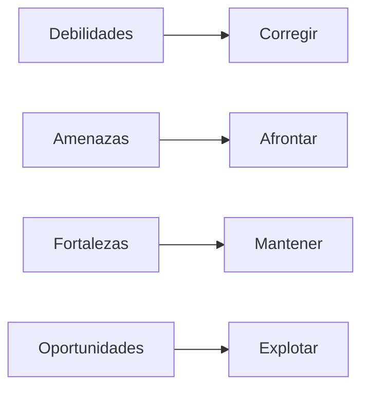

# Introducción

## Antes de empezar...

Imagina que alguien te pregunta: *«¿qué puede salir bien y qué puede salir mal en tu proyecto?»*.

Si respondes «todo saldrá bien» o «no lo sé», aún no has analizado tu proyecto. El análisis DAFO sirve precisamente para ordenar esa respuesta.

---

## ¿Qué es un análisis DAFO?

El DAFO es una herramienta que organiza la información sobre un proyecto en cuatro grupos:

- **D**ebilidades
- **A**menazas
- **F**ortalezas
- **O**portunidades

!!! info "Idea clave"

    El DAFO no es una lista de opiniones. Es un diagnóstico: separa lo que depende de ti de lo que depende del entorno.

---

## La matriz básica

|  | **Ayuda** | **Perjudica** |
|--------|--------|--------|
| **Interno** (depende de ti) | **Fortalezas** | **Debilidades** |
| **Externo** (depende del entorno) | **Oportunidades** | **Amenazas** |

### La pregunta clave

Para clasificar un factor, hazte dos preguntas:

1. ¿Depende de mí y de mi proyecto, o viene del exterior? → **interno o externo**.
2. ¿Me ayuda o me perjudica? → **positivo o negativo**.

---

## ¿Y qué es el CAME?

El DAFO diagnostica. El **CAME** decide qué hacer con el diagnóstico.

| Letra | Acción | Se aplica a |
|--------|--------|--------|
| **C** | **Corregir** | las debilidades |
| **A** | **Afrontar** | las amenazas |
| **M** | **Mantener** | las fortalezas |
| **E** | **Explotar** | las oportunidades |

!!! success "Idea clave"

    Un DAFO sin CAME se queda en una lista bonita. Lo valioso son las decisiones que tomas a partir de él.

---

## Errores frecuentes

!!! warning "Evítalos"

    - Escribir factores genéricos que valdrían para cualquier proyecto.
    - Confundir lo interno con lo externo.
    - Llenar todo de fortalezas y apenas poner debilidades.
    - Hacer listas enormes sin priorizar.
    - Escribir el DAFO y no tomar ninguna decisión a partir de él.

---

## ¿Qué espera encontrar el lector?

### ¿Conoce el autor su proyecto?
Los factores son concretos y realistas, no genéricos.

### ¿Es honesto el análisis?
Hay debilidades y amenazas reales, no solo virtudes.

### ¿Se distingue lo interno de lo externo?
Cada factor está en su cuadrante.

### ¿Se actúa a partir del análisis?
Hay acciones concretas, con responsable y plazo.

---

## Lo que aprenderás en esta unidad

1. Analizar las fortalezas y debilidades de tu proyecto.
2. Analizar las oportunidades y amenazas de su entorno.
3. Construir y cruzar la matriz DAFO.
4. Definir acciones CAME priorizadas.

---

## Lo que escribirás en tu memoria

- Un análisis interno y otro externo.
- La matriz DAFO.
- Las estrategias derivadas.
- Un plan de acción con las acciones elegidas.

---

## Para reflexionar

??? question "Piensa en tu proyecto"

    - ¿Qué es lo que mejor sabes hacer para llevarlo adelante?
    - ¿Qué es lo que más te preocupa que no salga bien?
    - ¿Qué existe ya ahí fuera que se parezca a tu idea?
    - ¿Qué cambiaría si dispusieras del doble de tiempo?

---

## Ideas clave

!!! success "Qué debes recordar"

    ✅ El DAFO separa lo interno de lo externo y lo positivo de lo negativo.

    ✅ Un buen DAFO es concreto, honesto y breve.

    ✅ El CAME convierte el diagnóstico en acciones.

    ✅ Las acciones deben ser realistas para tu tiempo y recursos.
