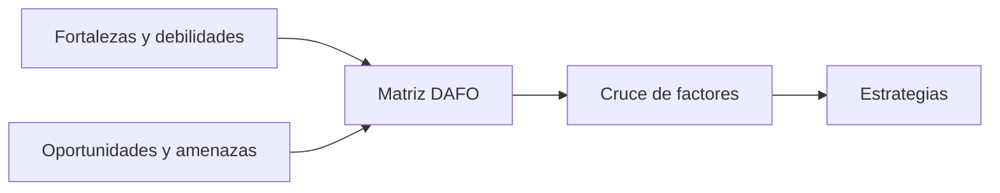

# La matriz DAFO

## Juntar las piezas

Ya tienes los cuatro grupos de factores. Ahora los reúnes en una sola matriz y los **cruzas** para sacar conclusiones.



---

## Paso 1 · Ordena los factores

Selecciona los **3 a 5 factores más importantes** de cada cuadrante y asígnales un código para poder referirte a ellos.

|  | **Ayuda** | **Perjudica** |
|--------|--------|--------|
| **Interno** | **Fortalezas** · F1, F2, F3 | **Debilidades** · D1, D2, D3 |
| **Externo** | **Oportunidades** · O1, O2, O3 | **Amenazas** · A1, A2, A3 |

!!! tip "Menos es más"

    Una matriz con 12 factores bien elegidos vale más que una con 40 factores de relleno.

---

## Paso 2 · Cruza los factores

Cada cruce combina un factor interno con uno externo y da lugar a un tipo de estrategia.

| | **Oportunidades** | **Amenazas** |
|--------|--------|--------|
| **Fortalezas** | **FO · Ofensivas.** Usar fortalezas para aprovechar oportunidades. | **FA · Defensivas.** Usar fortalezas para reducir amenazas. |
| **Debilidades** | **DO · De reorientación.** Superar debilidades aprovechando oportunidades. | **DA · De supervivencia.** Reducir debilidades y evitar amenazas. |

### Cómo se redacta un cruce

```text
FO: F1 + O1 → [Estrategia que usa F1 para aprovechar O1]
```

!!! info "Idea clave"

    Una estrategia útil nombra **qué factores combina** y **qué haría concretamente**.

---

## Caso práctico · ReservaSport

### Los factores

| Código | Factor |
|-------|--------|
| F1 | Alcance del MVP acotado y realista. |
| F2 | Usuarios y necesidades bien definidos. |
| F3 | Plan de trabajo con un margen del 20 %. |
| D1 | Poca experiencia desarrollando una aplicación completa. |
| D2 | Dedicación limitada: 2-3 horas diarias. |
| D3 | Trabajo individual. |
| O1 | Muchas instalaciones aún reservan por teléfono. |
| O2 | Herramientas y documentación gratuitas. |
| O3 | Usuarios acostumbrados a reservar por internet. |
| A1 | Aplicaciones de reservas consolidadas, de pago. |
| A2 | Normativa de protección de datos. |
| A3 | Usuarios con poca soltura digital. |

### Los cruces

| Tipo | Cruce | Estrategia |
|--------|--------|--------|
| FO | F1 + O1 | Centrar el MVP en instalaciones pequeñas que aún reservan por teléfono. |
| FO | F2 + O3 | Diseñar la interfaz siguiendo los hábitos de reserva online que ya conocen. |
| FA | F1 + A2 | Recoger únicamente los datos personales imprescindibles. |
| FA | F2 + A3 | Diseñar pantallas muy sencillas validadas con usuarios reales. |
| DO | D1 + O2 | Apoyarse en documentación y tutoriales gratuitos y elegir tecnologías conocidas. |
| DA | D2 + A1 | No competir en funciones: mantener el alcance sin ampliaciones. |

---

## Paso 3 · Comprueba que no te dejas nada

Revisa estas preguntas:

- [ ] ¿Cada debilidad importante tiene alguna estrategia que la aborde?
- [ ] ¿Cada amenaza importante tiene alguna respuesta?
- [ ] ¿Alguna fortaleza o oportunidad se queda sin aprovechar?
- [ ] ¿Las estrategias son realistas con mi tiempo y recursos?

!!! warning "Error frecuente"

    Escribir estrategias que no se pueden hacer («superar a la competencia», «tener miles de usuarios»). Una estrategia debe estar al alcance de tu proyecto.

---

## Actividad 1 · Cruza dos factores

Dados:

- **F:** «Domino bien SQL».
- **O:** «Muchos centros quieren digitalizar procesos».
- **D:** «Solo puedo trabajar 2 horas al día».
- **A:** «Existen herramientas gratuitas muy completas».

Escribe una estrategia FO y una DA.

??? success "Solución orientativa"

    - **FO:** aprovechar el dominio de SQL para ofrecer un buen sistema de consulta de datos a centros que quieren digitalizar procesos.
    - **DA:** con solo 2 horas al día, no competir con herramientas completas; ofrecer una solución mínima y específica.

---

## Actividad 2 · Tu matriz DAFO

1. Elige 3 factores de cada cuadrante, con sus códigos.
2. Rellena la matriz.
3. Redacta **como mínimo 4 cruces**, uno de cada tipo (FO, FA, DO, DA).

```text
FO: F_ + O_ →
FA: F_ + A_ →
DO: D_ + O_ →
DA: D_ + A_ →
```

---

## Actividad 3 · Abogado del diablo

En parejas, intercambiad vuestras matrices.

1. Lee la matriz de tu compañero o compañera.
2. Cuestiona **un factor de cada cuadrante**: ¿es concreto?, ¿es realmente interno o externo?, ¿es verdad?
3. Propón **una debilidad o amenaza que echas en falta**.
4. Recibe sus preguntas y ajusta tu matriz.

!!! tip "Para qué sirve"

    Quien no conoce tu proyecto ve cosas que tú has dejado de ver.

---

## Ejemplos de redacción para la memoria

| Nivel | Ejemplo |
|---------|---------|
| ❌ Pobre | Con el DAFO se ve lo que hay que mejorar. |
| ⚠️ Básico | Se ha elaborado la matriz DAFO del proyecto. |
| ✅ Bueno | La matriz DAFO recoge tres factores por cuadrante y propone estrategias cruzadas. |
| ⭐ Excelente | La matriz DAFO recoge tres factores por cuadrante. Del cruce de factores se derivan seis estrategias, entre ellas centrar el MVP en instalaciones pequeñas que aún reservan por teléfono (F1 + O1) y recoger solo los datos personales imprescindibles (F1 + A2). |

---

## ¿Cómo aparecerá esto en la memoria?

### Plantilla reutilizable

```text
La matriz DAFO del proyecto es la siguiente:

[Tabla con los cuatro cuadrantes y sus códigos]

Del cruce de factores se derivan las siguientes estrategias:

- FO: [F + O → estrategia]
- FA: [F + A → estrategia]
- DO: [D + O → estrategia]
- DA: [D + A → estrategia]
```

---

## Lo que irá a la memoria

```text
4.3. Matriz DAFO

- Matriz con los cuatro cuadrantes.
- Estrategias derivadas del cruce de factores.
```

---

## Autoevaluación

- [ ] He elegido los factores más importantes de cada cuadrante.
- [ ] Les he asignado un código.
- [ ] He redactado al menos un cruce de cada tipo.
- [ ] Mis estrategias son realistas.
- [ ] Podría redactar el apartado 4.3 de mi memoria.
